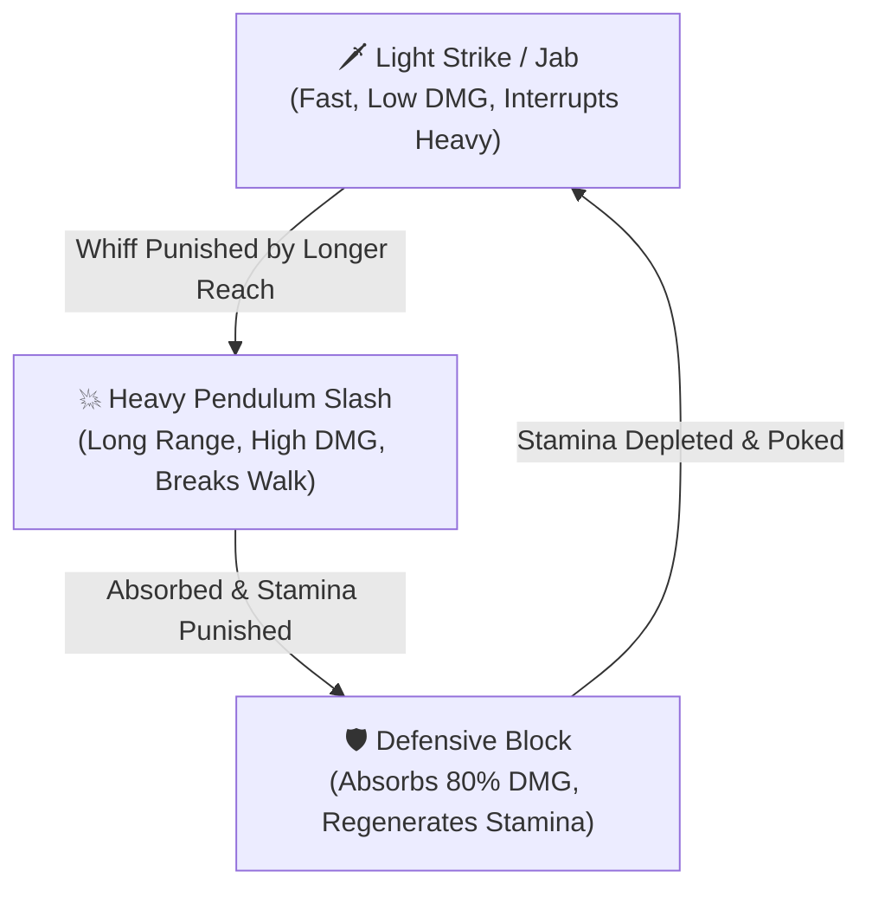
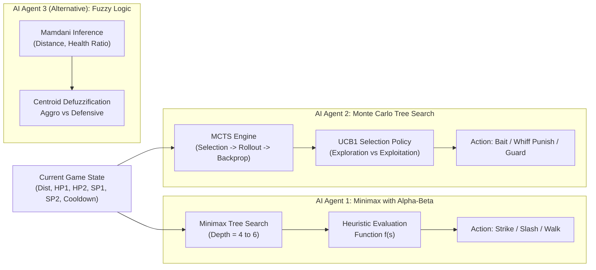
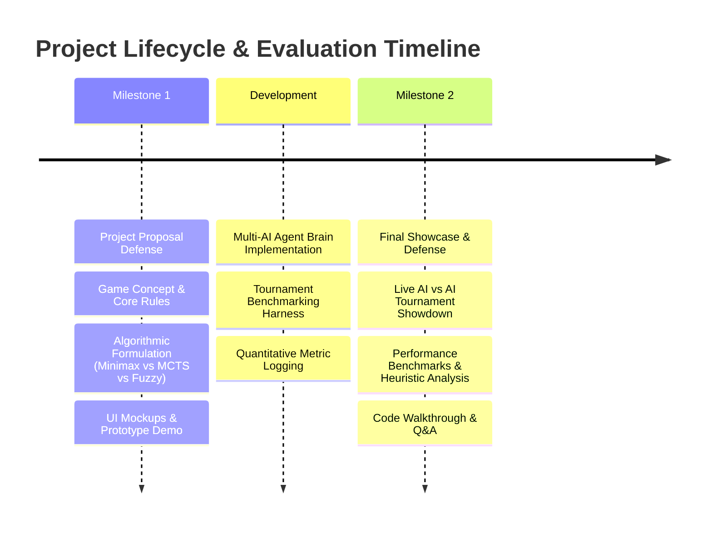

# 🎮 CSE 3210: Artificial Intelligence Laboratory
## Comprehensive Course Curriculum, Project Proposal & 2D Tactical Fighting Game Specification

---

## 📌 Executive Summary

This document serves as the master specification for the term project in **CSE 3210: Artificial Intelligence Laboratory** (Department of Computer Science and Engineering, Khulna University of Engineering & Technology - KUET). 

It details:
1. **The Complete Course Curriculum**: Deep technical overview of all 10 laboratory modules and computational AI paradigms covered throughout the term.
2. **Teacher's Project Mandates & Requirements**: Constraints, required operational modes (AI vs. AI mandatory benchmark, Human vs. AI optional demo), visual polish expectations, and milestone evaluations.
3. **The Proposed Game Concept ("Shinobi Footsies: Duel of Algorithms")**: A 2D retro tactical martial arts fighting game built around spacing, timing, stamina economy, and neutral-game combat.
4. **Algorithmic Mapping & Agent Architecture**: Concrete mathematical and algorithmic formulations for implementing diverse AI paradigms (Minimax with $\alpha$-$\beta$ pruning, Monte Carlo Tree Search, and Mamdani Fuzzy Inference) to power rival fighters.
5. **UI/UX Architecture & Interface Mockups**: Visual HUD layout, stage demarcation, real-time algorithmic telemetry monitors, and combat logs.
6. **Current Implementation Inventory**: Exhaustive catalog of pre-built working code, 60 FPS Pygame state machine, HTML5 visualizer, and 21-frame 8-bit sprite asset suite.
7. **Presentation & Defense Blueprints**: Slide-by-slide structure for both the initial **Project Proposal Presentation** and the final **Project Showcase & Defense**.

---

## 📚 PART 1: Course Content & Laboratory Curriculum

The syllabus of **CSE 3210** spans classical search, heuristic optimization, game-theoretic adversarial decision making, uncertain reasoning, constraint satisfaction, formal logic inference, stochastic planning, and automated reasoning.

### Detailed Module-by-Module Breakdown

| Lab Module | Core Topic | Fundamental Algorithms & Concepts | Mathematical & Theoretical Foundations | Typical Problem Domains |
| :--- | :--- | :--- | :--- | :--- |
| **Lab 01** | **Introduction to Python for AI** | Data structures (lists, dicts, tuples, sets), NumPy matrix operations, Matplotlib visualization, object-oriented state modeling. | Algorithmic complexity, vectorization, clean state-space abstractions. | Environment simulation, grid manipulation. |
| **Lab 02** | **Uninformed (Blind) Search** | Breadth-First Search (BFS), Depth-First Search (DFS), Uniform-Cost Search (UCS), Depth-Limited Search (DLS), Iterative Deepening Search (IDS). | Completeness, time & space complexity, branching factor $b$, search depth $d$, path cost $g(n)$. | Maze pathfinding, 8-puzzle state transitions, graph traversal. |
| **Lab 03** | **Informed (Heuristic) Search** | Greedy Best-First Search, $\text{A}^*$ Search, Iterative Deepening $\text{A}^*$ ($\text{IDA}^*$). | Heuristic function $h(n)$, evaluation function $f(n) = g(n) + h(n)$, heuristic admissibility ($h(n) \le h^*(n)$) and consistency (triangle inequality). | Shortest path routing, spatial navigation, grid-world obstacle evasion. |
| **Lab 04** | **Adversarial Search & Game Playing** | Two-Player Zero-Sum Games, Minimax Algorithm, Alpha-Beta ($\alpha$-$\beta$) Pruning, Horizon Effect, Static Evaluation Functions. | Game trees, depth-bounded search, minimax theorem, cutoff utility $\alpha \ge \beta$, terminal state valuation, branching reduction from $O(b^d)$ to $O(b^{d/2})$. | Tic-Tac-Toe, Connect Four, Chess/Checkers endgames, tactical turn duels. |
| **Lab 05** | **Fuzzy Logic & Fuzzy Inference Systems (FIS)** | Mamdani Fuzzy Inference, Linguistic Variables, Triangular & Trapezoidal Membership Functions, Fuzzification, Rule Base evaluation (T-norm/S-norm), Defuzzification (Centroid, Mean of Maximum). | Degree of truth $\mu_A(x) \in [0, 1]$, fuzzy rule implication ($\min / \text{product}$), fuzzy aggregation ($\max$), center of gravity formula: $z^* = \frac{\int z \mu_C(z) dz}{\int \mu_C(z) dz}$. | Dynamic braking, autonomous combat stance selection, risk assessment, aggro-meter. |
| **Lab 06** | **Constraint Satisfaction Problems (CSP)** | Backtracking Search for CSPs, Variable Ordering Heuristics (Minimum Remaining Values - MRV, Degree Heuristic), Value Ordering (Least Constraining Value - LCV), Constraint Propagation (Forward Checking, AC-3 Arc Consistency). | Constraint graphs, binary/unary constraints, domain reduction, arc consistency condition $X_i \to X_j$. | $N$-Queens puzzle, Sudoku solver, map coloring, resource scheduling. |
| **Lab 07** | **Knowledge Representation & Propositional Logic** | Knowledge-Based Agents (KB), Propositional Inference Engine, Truth Table Enumeration, Conjunctive Normal Form (CNF) conversion, Resolution Refutation, Horn Clauses, Forward & Backward Chaining. | Entailment $KB \models \alpha$, soundness & completeness, logical equivalences (De Morgan's laws, distributive laws), resolution rule: $\frac{l_1 \lor \cdots \lor l_k, \quad m_1 \lor \cdots \lor m_n}{l_1 \lor \cdots \lor l_{i-1} \lor l_{i+1} \lor \cdots \lor l_k \lor m_1 \lor \cdots \lor m_{j-1} \lor m_{j+1} \lor \cdots \lor m_n}$. | Wumpus World, safe step deduction, rule-based reasoning systems. |
| **Lab 08** | **Monte Carlo Tree Search (MCTS)** | Stochastic Search under Large Action Spaces, 4-Phase MCTS Loop: **Selection**, **Expansion**, **Simulation (Rollout)**, **Backpropagation**, Upper Confidence Bound applied to Trees (UCB1). | Exploration vs. Exploitation balance, UCB1 formula: $v_i + C \sqrt{\frac{\ln N}{n_i}}$, convergence to optimal minimax values without explicit domain heuristics. | Go, large-branching board games, simultaneous combat resolution. |
| **Lab 09** | **Automated Planning & PDDL** | Planning Domain Definition Language (PDDL), STRIPS representation, Predicates, Action schemas, Preconditions, Positive/Negative Effects, Forward/Backward state-space planning. | First-order relational representations, world state as set of grounded positive literals, goal satisfaction checking. | Blocks World, logistics package delivery, combat combo action sequencing. |
| **Lab 10** | **Natural Language Processing & Syntactic Parsing** | Context-Free Grammars (CFG), Chomsky Normal Form (CNF), Cocke-Younger-Kasami (CYK) algorithm, Chart Parsing. | Grammar productions $A \to BC$ or $A \to a$, dynamic programming chart filling, parse tree derivation. | Natural language dialogue, intent classification. |
| **Supplementary** | **Genetic Algorithms (GA)** | Population Initialization, Fitness Function Design, Selection mechanisms (Roulette Wheel, Tournament), Crossover operators, Mutation rate. | Evolutionary optimization, schema theorem, exploration of high-dimensional parameter spaces. | Optimal weight tuning for AI evaluation functions, procedural moveset balancing. |

---

## 🎯 PART 2: Project Specifications & Teacher Mandates

Based on the laboratory project guidelines communicated by the course instructor, the project must adhere to the following non-negotiable requirements:

### 1. Mandatory Dual-AI Architecture (AI vs. AI)
- **At Least Two Distinct AI Agents**: The game must support at least two separate AI agents implementing **fundamentally different algorithms** (e.g., Minimax vs. MCTS, or Minimax vs. Fuzzy Logic, rather than two identical heuristic bots).
- **Mandatory AI vs. AI Mode**: The system must feature an automated, real-time competition mode where AI Agent 1 battles AI Agent 2 autonomously with zero human intervention. This enables objective benchmarking, decision speed measurement, and behavioral comparisons.
- **Human vs. AI Mode (Interactive Gameplay)**: An interactive human-player mode (via keyboard/controller) must be available for testing, grading demonstration, and fun gameplay against either AI agent.

### 2. High Visual Quality & Interface Polish
- The project **must not** be a rudimentary command-line text game or a bare, static grid.
- It requires an attractive, intuitive graphic user interface (GUI) with:
  - Real-time animation cycles (idle, movement, attack, guard, damage reaction).
  - Clear visual feedback for combat events (health gauges, stamina bars, round countdown timer, floating damage/block popups).
  - Live algorithmic telemetry panel displaying depth, evaluated nodes, win probabilities, or fuzzy membership states.

### 3. Academic Evaluation Milestones
1. **Milestone 1: Project Proposal Presentation**:
   - High-level overview of the game concept and mechanics.
   - Initial UI mockup / visual prototype demonstration.
   - Algorithmic specification: Which AI algorithm is assigned to which agent, justification for selection, and state representation.
2. **Milestone 2: Final Project Demonstration & Defense**:
   - Complete working software demonstration.
   - Live AI vs. AI tournament showcasing tactical differences.
   - Comparative empirical analysis (win/loss ratios, average decision latency, branch pruning efficiency).

---

## 🥊 PART 3: The Game Concept — "Shinobi Footsies: Duel of Algorithms"

### 1. Genre & Philosophy
- **Genre**: 2D Tactical Retro Fighting Game (inspired by *Footsies*, *Street Fighter III: 3rd Strike*, and *Bushido Blade*).
- **Core Concept**: Traditional fighting games are often overwhelmed by complex 50-move command lists and execution barriers. *Shinobi Footsies* strips the fighting game down to its purest academic core: **neutral spacing (footsies), timing, stamina economy, whiff-punishing, and predictive counter-play**.
- **Setting & Characters**:
  - **Player 1 ("Kuro" - The Shadow Shinobi)**: Clad in charcoal gi with crimson headband, wielding a Japanese steel kunai/tanto.
  - **Player 2 ("Aka" - The Crimson Shinobi)**: Clad in deep crimson gi with imperial gold headband and sash.

```
+-----------------------------------------------------------------------------------+
|  [P1: KURO - MINIMAX AI] [==========] 80 HP       TIME: 74     100 HP [==========] [P2: AKA - MCTS AI]  |
|  STAMINA: [========  ]                                       STAMINA: [==========] |
+-----------------------------------------------------------------------------------+
|                                                                                   |
|                                                                                   |
|                                  <- DISTANCE: 110px ->                            |
|                                                                                   |
|            (o_o)                                            (^_^)                 |
|            <) )>==-[🗡️]        CRITICAL HIT! -24 HP!        <) )>==-[🗡️]           |
|            /   \                                            /   \                 |
|  ==========[###]============================================[###]================= |
|                      STAGE DEMARCATION: 12 POSITION MARKERS                       |
+-----------------------------------------------------------------------------------+
|  AI TELEMETRY:                                                                    |
|  > P1 (Minimax): Depth 4 searched 428 nodes | Utility: +14.2 | Action: HEAVY SLASH |
|  > P2 (MCTS): 180 rollouts (UCB1 = 1.41)   | Win Prob: 42%  | Action: DEFEND     |
+-----------------------------------------------------------------------------------+
```

### 2. Combat Mechanics & The Triangle Balance

The combat system is governed by a strictly balanced rock-paper-scissors priority system:



### 3. Complete 6-Action Moveset & Frame Specifications

Every action is backed by handcrafted 8-bit spritesheets and discrete frame metrics:

| Action | Frame Count | Active Reach | Base Damage | Stamina Cost / Gain | Tactical Function |
| :--- | :---: | :---: | :---: | :---: | :--- |
| **Idle Stance** | 4 frames | — | 0 HP | +0.2 SP/frame | Natural breathing loop; blade readied in front guard. |
| **Combat Walk** | 4 frames | Spacing | 0 HP | 0 SP | 4-beat locomotion cycle. Used for micro-spacing and baiting whiffs. |
| **Light Strike (Jab)** | 3 frames | Short ($85\text{px}$) | 10 HP | -8 SP | Fast 3-frame lunge poke. Interrupts startup of heavy slash; safe on block. |
| **Heavy Slash** | 5 frames | Long ($135\text{px}$) | 24 HP | -22 SP | 5-frame pendulum arc swing. High damage whiff punisher; vulnerable on whiff. |
| **Defensive Guard** | 2 frames | Self | -80% DMG | -10 SP (on block) | Braced block. Absorbs hits with minimal chip damage; recovers neutral stamina. |
| **Hit Stun / Flinch** | 3 frames | Self | Taken | 0 SP | Uninterruptible stagger recoil upon taking an unblocked strike. |

### 4. Cross-Up & Dynamic Auto-Facing System
In professional fighting games, if a player jumps, walks, or lunges past the opponent, the characters must **cross up** and dynamically mirror their sprites to face each other.
- **Auto-Turn Logic**: Whenever fighters are in neutral or walking state, the engine continuously checks:
  $$\text{Facing Direction} = \begin{cases} \text{Right} & \text{if } x_{\text{self}} < x_{\text{opponent}} \\ \text{Left} & \text{if } x_{\text{self}} \ge x_{\text{opponent}} \end{cases}$$
- **Pre-Cached Dual-Direction Sprites**: To maintain a locked 60 FPS, all frames are pre-flipped horizontally (`pygame.transform.flip()`) into `anims_right` and `anims_left` at boot, eliminating runtime CPU garbage collection.
- **Directional Lunges & Knockbacks**: Forward lunges scale with $\text{facing\_dir} \in \{+1, -1\}$, and knockbacks physically push the defender away from the attacker's coordinates.

---

## 🧠 PART 4: Algorithmic Mapping to Game AI

The game environment is specifically structured as a discrete Markov Decision Process (MDP) / Extensive-Form Game, making it a natural playground for algorithms taught in CSE 3210.



### 1. Agent 1: Adversarial Search (Minimax with $\alpha$-$\beta$ Pruning) [Lab 04]
- **Role**: Cold, calculating, optimal tactician that calculates deterministic sequences of moves.
- **State Representation**: $S = (x_1, x_2, \text{hp}_1, \text{hp}_2, \text{stamina}_1, \text{stamina}_2, \text{state}_1, \text{state}_2)$.
- **Search Tree Formulation**:
  - Each decision beat allows actions $A = \{\text{Walk Forward}, \text{Walk Back}, \text{Light Jab}, \text{Heavy Slash}, \text{Guard}\}$.
  - Zero-sum utility evaluation function at search horizon depth $d$:
    $$f(S) = w_1 \cdot (\text{hp}_1 - \text{hp}_2) + w_2 \cdot (\text{stamina}_1 - \text{stamina}_2) + w_3 \cdot \text{SpacingAdvantage}(S) + w_4 \cdot \text{VulnerabilityPenalty}(S)$$
  - Where:
    - $\text{SpacingAdvantage}(S) = +15$ if distance matches agent's optimal attack reach and opponent is in recovery frames.
    - $\text{VulnerabilityPenalty}(S) = -25$ if agent whiffs a heavy slash while within opponent's jab reach.
- **$\alpha$-$\beta$ Pruning**: Prunes unpromising branches where $\alpha \ge \beta$, allowing the agent to evaluate up to 6 beats ahead within $<16\text{ms}$ per frame.

### 2. Agent 2: Monte Carlo Tree Search (MCTS) [Lab 08]
- **Role**: Adaptive, creative strategist capable of handling simultaneous moves without hand-crafted heuristic bias.
- **Algorithm Flow**:
  1. **Selection**: Traverse the tree from the root using UCB1:
     $$\text{UCB1}(s, a) = Q(s, a) + C \sqrt{\frac{\ln N(s)}{N(s, a)}}$$
     where $C = \sqrt{2} \approx 1.414$ balances exploitation of high win-rate moves with exploration of unvisited actions.
  2. **Expansion**: Expand non-terminal leaf node by adding legal action branches.
  3. **Simulation (Rollout)**: Execute rapid, semi-random simulation rollouts for 5–8 combat beats using a lightweight heuristic rollout policy.
  4. **Backpropagation**: Propagate terminal health difference score back up the tree to update visit counts $N(s)$ and total value $Q(s)$.
- **Key Advantage**: Discovers emergent "feinting" tactics (e.g., stepping forward to bait a heavy slash, then stepping back, and punishing during the opponent's 480ms recovery window).

### 3. Agent 3: Mamdani Fuzzy Inference System (FIS) [Lab 05]
- **Role**: Organic, human-like instinctual fighter that operates on linguistic degrees of aggression and caution.
- **Input Variables & Membership Functions**:
  1. $\text{Distance} \in [0, 400]\text{px}$: $\text{Close } [0, 90]$, $\text{Mid } [70, 160]$, $\text{Far } [140, 400]$.
  2. $\text{Health Ratio} = \frac{\text{hp}_{\text{self}}}{\text{hp}_{\text{opp}}} \in [0, 2]$: $\text{Critical } [0, 0.6]$, $\text{Even } [0.5, 1.2]$, $\text{Dominant } [1.1, 2.0]$.
  3. $\text{Opponent Action State}$: $\text{Recovering}$, $\text{Neutral}$, $\text{Attacking}$.
- **Fuzzy Rule Base Examples**:
  - `IF Distance IS Mid AND Opponent IS Recovering THEN Action IS Heavy Slash (Aggressive)`.
  - `IF Distance IS Close AND Health IS Critical THEN Action IS Defensive Guard (High Weight)`.
  - `IF Distance IS Far AND Stamina IS Normal THEN Action IS Advance (Neutral)`.
- **Defuzzification**: Center of Gravity / Centroid method maps continuous fuzzy outputs to concrete action velocities and trigger probabilities.

### 4. Agent 4: Heuristic Genetic Algorithm (GA) [Supplementary Optimization]
- **Role**: Offline evolutionary optimizer that evolves the weights $(w_1, w_2, w_3, w_4)$ of the Minimax evaluation function by running autonomous 100-round tournaments over generations.

---

## 🖥️ PART 5: UI/UX Architecture & Interface Layout

### 1. In-Game Retro Arcade HUD
The screen layout ($800 \times 450$ resolution, scalable to 1080p/4K) is partitioned into functional zones:

```
+-----------------------------------------------------------------------------------+
| [AVATAR] P1: KURO [MINIMAX-AI]                     P2: AKA [MCTS-AI] [AVATAR]     |
| [========================] 100 HP   [  99  ]     [========================] 100 HP|
| [===================     ] 78 SP   ROUND TIMER   [========================] 100 SP|
+-----------------------------------------------------------------------------------+
|                                                                                   |
|                                                                                   |
|                                                                                   |
|                       <--- DISTANCE: 120px --->                                   |
|                                                                                   |
|                                                                                   |
|                 🥷 P1 (Cyan Glow)               🥷 P2 (Pink Glow)                 |
|       ==========[###]===========================[###]=====================        |
|                    STAGE FLOORS & NEON MEASUREMENT GRID                           |
+-----------------------------------------------------------------------------------+
| [MANUAL OVERRIDE: TAB]  [A/D] Walk  |  [S] Guard  |  [J] Light Jab  |  [K] Slash  |
+-----------------------------------------------------------------------------------+
```

### 2. Algorithmic Telemetry Dashboard
During AI vs. AI matches, an on-screen HUD drawer or side panel displays live telemetry:
- **Search Depth Indicator**: Shows current ply depth reached by Minimax.
- **Node Evaluation Counter**: Nodes explored per second (NPS) and pruned branches.
- **MCTS Rollout Gauge**: Number of simulated game trajectories completed.
- **State Evaluation Bar**: Real-time evaluation bar (similar to chess engine evaluation bars) showing who holds tactical advantage.

---

## 🗃️ PART 6: Implementation Inventory & Ready Assets

All front-end assets, animations, and combat engines are already built, tested, and stored in the active repository:

### 1. Standalone Executable Game Engine
- **File**: [`run_ninja_duel.py`](file:///F:/__KUET_CSE22/3-2/Lab/Artificial%20Intelligence%20Lab/run_ninja_duel.py)
- **Framework**: Python 3.13 / Pygame 2.6.1 (60 FPS locked state machine).
- **Capabilities**:
  - Real-time spritesheet slicing and hardware-accelerated rendering.
  - Dynamic cross-up detection and auto-facing horizontal sprite mirroring.
  - Active hitboxes, pushboxes, stamina regeneration, and floating damage numbers.
  - Instant toggle between **Manual vs. AI** and **AI vs. AI Battle Mode** via `[TAB]`.

### 2. Interactive Browser Visualizer & Architecture Studio
- **File**: [`interactive_concepts_visualizer.html`](file:///F:/__KUET_CSE22/3-2/Lab/Artificial%20Intelligence%20Lab/interactive_concepts_visualizer.html)
- **Capabilities**:
  - Live turn-by-turn combat beat simulator (`⚡ EXECUTE NEXT BEAT`).
  - Auto-tournament tournament play (`▶ AUTO-TOURNAMENT PLAY`).
  - Live animated GIF sprite overlays with zero-ghosting `disposal=2` rendering.
  - Interactive tabs covering Concept 1 (Footsies), Concept 2 (Cyber-Grid), and the Syllabus Mapping matrix.

### 3. Production Sprite & Animation Suite (21 Discrete Frames)
Stored in [`assets/sprites/ninja/`](file:///F:/__KUET_CSE22/3-2/Lab/Artificial%20Intelligence%20Lab/assets/sprites/ninja/):
- **12 Animated GIFs** (6 actions $\times$ 2 fighters) rendered with `disposal=2` clean frame clears.
- **12 Spritesheets** in both $10\times$ retro scale and $1\times$ native resolution.
- **Master Moveset Poster**: [`ninja_master_moveset_poster.png`](file:///F:/__KUET_CSE22/3-2/Lab/Artificial%20Intelligence%20Lab/assets/sprites/ninja/ninja_master_moveset_poster.png) (all 21 frames across 6 combat actions).
- **Face-Off Splash Banner**: [`ninja_faceoff_battle.png`](file:///F:/__KUET_CSE22/3-2/Lab/Artificial%20Intelligence%20Lab/assets/sprites/ninja/ninja_faceoff_battle.png).

### 4. Custom Reusable Skill
- **Skill Name**: `pixel-sprite-forge`
- **Location**: [`.agents/skills/pixel-sprite-forge/SKILL.md`](file:///F:/__KUET_CSE22/3-2/Lab/Artificial%20Intelligence%20Lab/.agents/skills/pixel-sprite-forge/SKILL.md)
- **Purpose**: Caveman-dense, token-optimized cheatsheet and code templates for programmatic 8-bit sprite generation, ground-locking (Row 23 rule), pendulum arc curves, and Pillow GIF disposal fixes.

---

## 📽️ PART 7: Presentation Roadmaps & Slide Blueprints

Use the structured slide outlines below to prepare your proposal slides (Canva/PowerPoint/Google Slides) and deliver your final defense.



---

### 📋 Milestone 1: Project Proposal Presentation (Slide-by-Slide Blueprint)

#### Slide 1: Title Slide
- **Title**: Shinobi Footsies: Autonomous Multi-Agent Combat Arena
- **Subtitle**: A 2D Tactical Fighting Game Benchmark for Adversarial Search & Decision Algorithms
- **Course**: CSE 3210: Artificial Intelligence Laboratory
- **Team Members**: Names, Roll Numbers, Department of CSE, KUET.
- **Instructor / Supervisor**: Course Teacher's Name.

#### Slide 2: Problem Statement & Motivation
- **Context**: Fighting games represent complex multi-agent environments involving partial predictability, micro-spacing, and time-critical decision making.
- **Goal**: Build a clean, high-performance 2D retro fighting game to benchmark competing AI algorithms (Adversarial Minimax vs. Stochastic MCTS vs. Rule-based Fuzzy Logic).
- **Relevance to Syllabus**: Directly implements algorithms from **Lab 04 (Adversarial Search)**, **Lab 08 (MCTS)**, and **Lab 05 (Fuzzy Logic)**.

#### Slide 3: Game Concept & Core Rules
- **Genre**: 2D Tactical Retro Footsies / Martial Arts Duel.
- **Mechanics**:
  - Discrete health ($100\text{ HP}$), stamina economy ($100\text{ SP}$), and horizontal spacing arena.
  - Rock-Paper-Scissors combat triangle: **Light Strike** beats Heavy Startup, **Heavy Slash** punishes spacing whiffs, **Defensive Guard** absorbs heavy blows and recharges stamina.
  - Dynamic cross-up auto-facing system.

#### Slide 4: Game Interface & Visual Mockup
- **Showcase Visuals**:
  - Embed [`ninja_faceoff_battle.png`](file:///F:/__KUET_CSE22/3-2/Lab/Artificial%20Intelligence%20Lab/assets/sprites/ninja/ninja_faceoff_battle.png) and [`ninja_master_moveset_poster.png`](file:///F:/__KUET_CSE22/3-2/Lab/Artificial%20Intelligence%20Lab/assets/sprites/ninja/ninja_master_moveset_poster.png).
  - Screenshots from the working Pygame duel window (`run_ninja_duel.py`).
  - Highlight HUD elements: Health bars, Stamina meters, distance indicator, and real-time AI decision log.

#### Slide 5: AI Architecture 1 — Adversarial Minimax with Alpha-Beta
- **Algorithm**: Minimax with Alpha-Beta Pruning (from Lab 04).
- **Depth**: 4 to 6 plies lookahead.
- **Utility Function**: Evaluates net HP difference, stamina margin, spacing reach advantage, and vulnerability penalties during recovery frames.
- **Expected Personality**: Highly disciplined, bait-and-punish tactician that never makes greedy, uncalculated gambles.

#### Slide 6: AI Architecture 2 — Monte Carlo Tree Search (MCTS)
- **Algorithm**: MCTS with UCB1 exploration (from Lab 08).
- **4 Phases**: Selection, Expansion, Random Rollouts (Simulations), Backpropagation.
- **Advantage**: Does not require manual depth-limit tuning; discovers multi-beat combo feints through probabilistic simulation.
- **Expected Personality**: Opportunistic, creative, capable of surprising aggressive traps.

#### Slide 7: Operational Modes & Technical Architecture
- **Mode A (Mandatory)**: **AI vs. AI Tournament Mode** (autonomous, fast-paced, logged metrics).
- **Mode B (Interactive)**: **Human vs. AI Mode** (player testing with keyboard).
- **Tech Stack**: Python 3.13, Pygame 2.6.1, Pillow, HTML5/Canvas/CSS3.
- **Architecture**: Modular decoupling of the Game Physics/State Engine from the AI Decision Planners.

#### Slide 8: Expected Deliverables & Project Timeline
- **Phase 1 (Completed)**: Core engine, full 21-frame 8-bit sprite suite, Pygame state machine, HTML visualizer.
- **Phase 2 (Next)**: Deep algorithmic implementation of Minimax tree search and MCTS rollout workers.
- **Phase 3**: Automated 100-match benchmark suite, statistical win-rate logging, final presentation polish.

---

### 🏆 Milestone 2: Final Project Showcase & Defense Blueprint

#### 1. Live Demonstration Protocol
- **Demo 1: Human vs. AI**: Show responsiveness, collision detection, cross-up sprite mirroring, and guard mechanics.
- **Demo 2: AI vs. AI Tournament Showdown (The Main Event)**:
  - Run 5 consecutive rounds of **Minimax (Kuro)** vs. **MCTS (Aka)**.
  - Project the real-time decision telemetry onto the screen so the instructor can watch the tree depth and search evaluations in real time.

#### 2. Quantitative Results & Evaluation Metrics to Present
- **Win/Loss Matrix**: Tournament results across 100 autonomous matches.
- **Decision Latency**: Average milliseconds taken per combat beat ($\text{Minimax } \sim 4\text{ms}$ vs. $\text{MCTS } \sim 15\text{ms}$).
- **Search Efficiency**: Number of nodes pruned by $\alpha$-$\beta$ pruning versus full tree expansion.
- **Stamina Management Efficiency**: How effectively each algorithm avoided zero-stamina exhaustion.

#### 3. Anticipated Questions from the Instructor & Model Answers
- **Q: Why a 2D fighting game instead of a classic board game like Chess or Checkers?**
  - *Answer*: Traditional board games feature static turn-taking and massive pre-computed book moves. A fighting game introduces spatial continuous-to-discrete translation, micro-spacing (footsies), stamina resource constraints, and dynamic cross-ups. It proves that algorithms like Minimax and MCTS can solve real-time tactical environments without relying on rigid grid boards.
- **Q: How does Minimax handle simultaneous actions in a fighting game?**
  - *Answer*: We formulate simultaneous combat beats either as a Matrix Game (solving mixed-strategy Nash equilibria) or as a turn-based extensive-form game with a small frame lookahead where each beat resolves collisions based on startup frame priority.
- **Q: What is the computational bottleneck of MCTS in real-time games?**
  - *Answer*: Rollout depth. By bounding rollout horizons to 6–8 beats and using a lightweight heuristic rollout policy instead of pure random walks, MCTS achieves deep tactical foresight within the $16.6\text{ms}$ budget of a 60 FPS loop.

---

## 🚀 Conclusion & Next Steps

This document provides everything needed to:
1. Explain the academic and technical grounding to the course instructor.
2. Build professional proposal slides matching the exact blueprint in **Part 7**.
3. Integrate advanced AI tree search planners directly into the existing, fully operational [`run_ninja_duel.py`](file:///F:/__KUET_CSE22/3-2/Lab/Artificial%20Intelligence%20Lab/run_ninja_duel.py) engine.
