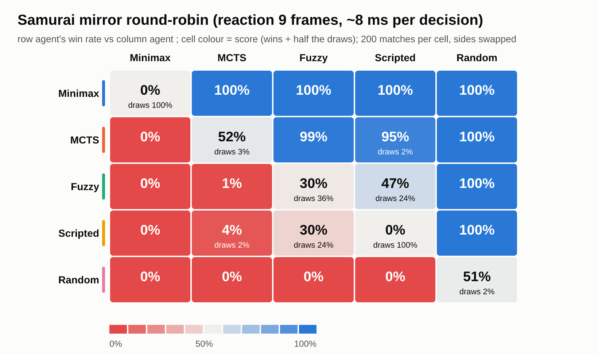
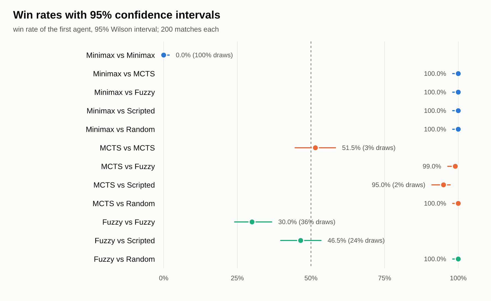
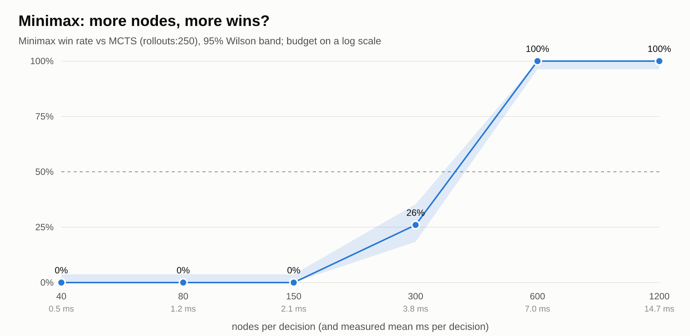
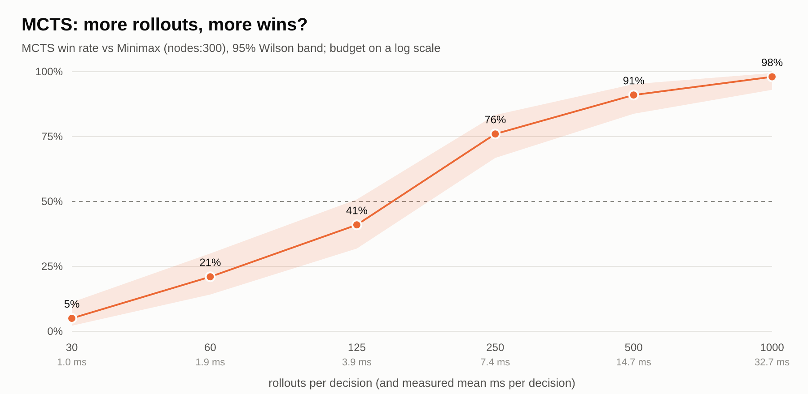
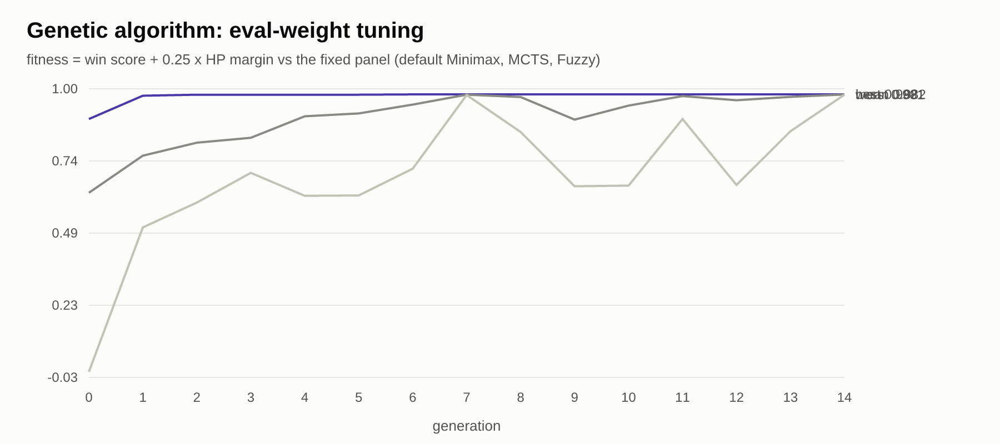
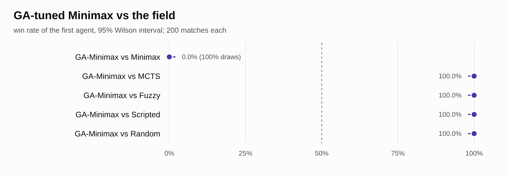
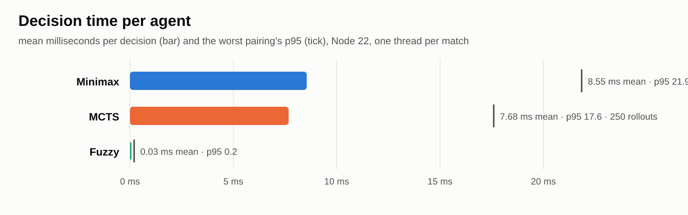

# AI benchmark: Samurai vs Samurai

Measured results for prompt 05 §5.3. Every number below is generated from the files in `game/tools/out/` by
`node game/tools/bench_tables.mjs` and `node game/tools/charts.mjs`, which also draws the charts in `docs/img/`.
The analysis is in §8, and the course write-up is [`ai_report.md`](ai_report.md).

## 1. Setup

| | |
|---|---|
| Match | Samurai vs Samurai (identical data), best of 3, 99-second rounds (5,940 frames), time-out decided by HP %, meter carried over |
| Sides | swapped every other match (odd match ids: agent A plays P2); per-match seeds derived from the run seed |
| Reaction | **9 frames for every agent** (the Hard level's delay; mistakes 0). With 0 frames the reactive Scripted bot blocked everything on the next frame (super-human), which distorted the comparison |
| Budgets | deterministic, chosen for **equal thinking time**: Minimax 600 nodes (measured 7.1–7.6 ms per decision), MCTS 250 rollouts (7.5–8.0 ms) |
| Size | 200 matches per pairing, round-robin with self-mirrors: **3,000 matches**, plus 1,000 for GA-Minimax, 1,200 for scaling curves, 480 for the difficulty ladder, 100 for the Normal-level Minimax mirror |
| Statistics | win rate with a 95 % Wilson interval; draws reported separately |
| Machines | Node 22. The Minimax self-mirror (all 3-round time-outs, about 50 s of CPU per match) ran in a cloud container; every other pairing ran on the project owner's PC. Same code, seeds and budgets; node and rollout budgets make results machine-independent |
| Reproduce | `npm run benchmark` in `game/` (or the `arena.mjs` lines in each file's `args`) |

## 2. Round-robin results (Samurai mirror)

Source: `game/tools/out/rr_main_summary.json` (3000 matches; seed 2026; reaction 9 frames; budgets minimax=nodes:600,mcts=rollouts:250).

| A vs B | n | A wins | 95% CI | B wins | 95% CI | draws | A HP margin / round | time-outs | A as P1 | A as P2 |
|---|---|---|---|---|---|---|---|---|---|---|
| Minimax vs Minimax | 200 | 0.0% | 0.0–1.9 | 0.0% | 0.0–1.9 | 100.0% | 0.0% | 100.0% | 0.0% | 0.0% |
| Minimax vs MCTS | 200 | 100.0% | 98.1–100.0 | 0.0% | 0.0–1.9 | 0.0% | 82.4% | 0.3% | 100.0% | 100.0% |
| Minimax vs Fuzzy | 200 | 100.0% | 98.1–100.0 | 0.0% | 0.0–1.9 | 0.0% | 84.7% | 0.0% | 100.0% | 100.0% |
| Minimax vs Scripted | 200 | 100.0% | 98.1–100.0 | 0.0% | 0.0–1.9 | 0.0% | 100.0% | 0.0% | 100.0% | 100.0% |
| Minimax vs Random | 200 | 100.0% | 98.1–100.0 | 0.0% | 0.0–1.9 | 0.0% | 88.4% | 0.0% | 100.0% | 100.0% |
| MCTS vs MCTS | 200 | 51.5% | 44.6–58.3 | 46.0% | 39.2–52.9 | 2.5% | 4.2% | 0.0% | 55.0% | 48.0% |
| MCTS vs Fuzzy | 200 | 99.0% | 96.4–99.7 | 1.0% | 0.3–3.6 | 0.0% | 58.8% | 0.0% | 100.0% | 98.0% |
| MCTS vs Scripted | 200 | 95.0% | 91.0–97.3 | 3.5% | 1.7–7.0 | 1.5% | 55.9% | 0.0% | 93.0% | 97.0% |
| MCTS vs Random | 200 | 100.0% | 98.1–100.0 | 0.0% | 0.0–1.9 | 0.0% | 91.6% | 0.0% | 100.0% | 100.0% |
| Fuzzy vs Fuzzy | 200 | 30.0% | 24.1–36.7 | 34.5% | 28.3–41.3 | 35.5% | 1.0% | 3.7% | 36.0% | 24.0% |
| Fuzzy vs Scripted | 200 | 46.5% | 39.7–53.4 | 30.0% | 24.1–36.7 | 23.5% | 1.7% | 0.0% | 48.0% | 45.0% |
| Fuzzy vs Random | 200 | 100.0% | 98.1–100.0 | 0.0% | 0.0–1.9 | 0.0% | 78.1% | 0.0% | 100.0% | 100.0% |
| Scripted vs Scripted | 200 | 0.0% | 0.0–1.9 | 0.0% | 0.0–1.9 | 100.0% | 0.0% | 0.0% | 0.0% | 0.0% |
| Scripted vs Random | 200 | 100.0% | 98.1–100.0 | 0.0% | 0.0–1.9 | 0.0% | 78.0% | 0.0% | 100.0% | 100.0% |
| Random vs Random | 200 | 50.5% | 43.6–57.4 | 47.5% | 40.7–54.4 | 2.0% | 0.5% | 0.2% | 54.0% | 47.0% |

| A vs B | side | damage / match | hits | blocked | hit ratio | chip dealt | ultimates used / landed | heavy whiffs | decisions | ms mean | ms p95 | nodes or rollouts / decision |
|---|---|---|---|---|---|---|---|---|---|---|---|---|
| Minimax vs Minimax | A: Minimax | 0 | 0.0 | 0.0 | 0.0% | 0 | 0.00 / 0.00 | 0.00 | 2229 | 10.71 | 21.85 | 600 |
| Minimax vs Minimax | B: Minimax | 0 | 0.0 | 0.0 | 0.0% | 0 | 0.00 / 0.00 | 0.00 | 2229 | 10.70 | 21.82 | 600 |
| Minimax vs MCTS | A: Minimax | 2235 | 18.5 | 0.4 | 97.7% | 42 | 0.99 / 0.10 | 0.01 | 165 | 7.10 | 12.39 | 600 |
| Minimax vs MCTS | B: MCTS | 356 | 2.8 | 19.4 | 12.6% | 42 | 0.60 / 0.04 | 0.01 | 92 | 7.63 | 12.94 | 250 |
| Minimax vs Fuzzy | A: Minimax | 2152 | 16.4 | 0.0 | 99.8% | 1 | 1.00 / 0.98 | 0.01 | 90 | 7.41 | 12.23 | 600 |
| Minimax vs Fuzzy | B: Fuzzy | 306 | 3.0 | 13.0 | 18.9% | 2 | 0.41 / 0.01 | 0.01 | 52 | 0.06 | 0.15 | – |
| Minimax vs Scripted | A: Minimax | 2144 | 18.0 | 0.0 | 100.0% | 0 | 1.00 / 1.00 | 0.00 | 101 | 7.56 | 12.57 | 600 |
| Minimax vs Scripted | B: Scripted | 0 | 0.0 | 25.0 | 0.0% | 0 | 0.00 / 0.00 | 0.00 | 66 | 0.00 | 0.01 | – |
| Minimax vs Random | A: Minimax | 2179 | 16.9 | 0.1 | 99.7% | 4 | 0.99 / 0.82 | 0.03 | 110 | 7.84 | 13.33 | 600 |
| Minimax vs Random | B: Random | 231 | 0.5 | 7.4 | 5.8% | 168 | 0.01 / 0.00 | 0.01 | 58 | 0.00 | 0.01 | – |
| MCTS vs MCTS | A: MCTS | 2146 | 15.7 | 2.5 | 86.5% | 125 | 0.97 / 0.23 | 1.43 | 119 | 7.52 | 11.12 | 250 |
| MCTS vs MCTS | B: MCTS | 2039 | 15.2 | 2.4 | 86.2% | 105 | 0.89 / 0.24 | 1.76 | 116 | 7.56 | 11.15 | 250 |
| MCTS vs Fuzzy | A: MCTS | 2173 | 15.0 | 0.5 | 96.8% | 26 | 1.01 / 0.97 | 0.76 | 50 | 7.70 | 14.13 | 250 |
| MCTS vs Fuzzy | B: Fuzzy | 866 | 7.3 | 1.2 | 86.1% | 14 | 0.13 / 0.03 | 0.01 | 53 | 0.05 | 0.15 | – |
| MCTS vs Scripted | A: MCTS | 2203 | 18.2 | 0.4 | 98.1% | 17 | 1.03 / 0.72 | 0.15 | 46 | 8.01 | 17.60 | 250 |
| MCTS vs Scripted | B: Scripted | 964 | 8.4 | 2.3 | 78.3% | 15 | 0.00 / 0.00 | 0.01 | 58 | 0.00 | 0.01 | – |
| MCTS vs Random | A: MCTS | 2141 | 13.8 | 1.0 | 93.2% | 13 | 0.99 / 0.95 | 1.22 | 45 | 7.66 | 13.88 | 250 |
| MCTS vs Random | B: Random | 169 | 1.3 | 0.1 | 90.2% | 2 | 0.00 / 0.00 | 0.46 | 42 | 0.00 | 0.01 | – |
| Fuzzy vs Fuzzy | A: Fuzzy | 2681 | 21.2 | 0.1 | 99.8% | 2 | 0.97 / 0.74 | 0.00 | 126 | 0.02 | 0.07 | – |
| Fuzzy vs Fuzzy | B: Fuzzy | 2652 | 21.2 | 0.1 | 99.8% | 3 | 0.94 / 0.68 | 0.00 | 127 | 0.02 | 0.06 | – |
| Fuzzy vs Scripted | A: Fuzzy | 2723 | 25.2 | 0.0 | 100.0% | 0 | 1.52 / 0.06 | 0.00 | 56 | 0.02 | 0.10 | – |
| Fuzzy vs Scripted | B: Scripted | 2669 | 24.0 | 0.0 | 100.0% | 0 | 0.00 / 0.00 | 0.00 | 63 | 0.00 | 0.01 | – |
| Fuzzy vs Random | A: Fuzzy | 2139 | 17.0 | 1.6 | 91.2% | 12 | 1.01 / 0.69 | 0.19 | 40 | 0.03 | 0.20 | – |
| Fuzzy vs Random | B: Random | 441 | 3.5 | 0.3 | 93.0% | 14 | 0.00 / 0.00 | 0.56 | 41 | 0.00 | 0.01 | – |
| Scripted vs Scripted | A: Scripted | 3051 | 27.0 | 0.0 | 100.0% | 0 | 0.00 / 0.00 | 0.00 | 51 | 0.00 | 0.01 | – |
| Scripted vs Scripted | B: Scripted | 3051 | 27.0 | 0.0 | 100.0% | 0 | 0.00 / 0.00 | 0.00 | 51 | 0.00 | 0.01 | – |
| Scripted vs Random | A: Scripted | 2115 | 20.8 | 2.4 | 89.8% | 3 | 0.00 / 0.00 | 0.04 | 49 | 0.00 | 0.02 | – |
| Scripted vs Random | B: Random | 441 | 3.7 | 0.6 | 85.3% | 34 | 0.00 / 0.00 | 0.09 | 44 | 0.00 | 0.01 | – |
| Random vs Random | A: Random | 1997 | 11.7 | 0.8 | 93.7% | 15 | 0.74 / 0.44 | 2.70 | 125 | 0.00 | 0.00 | – |
| Random vs Random | B: Random | 1987 | 11.6 | 0.8 | 93.5% | 22 | 0.71 / 0.41 | 2.56 | 125 | 0.00 | 0.00 | – |

## 3. Sanity checks

| Check | Result | Verdict |
|---|---|---|
| Every real agent beats Random by more than 90 % | Minimax 100 %, MCTS 100 %, Fuzzy 100 % (200 / 200 each) | pass |
| Self-mirrors are about 50 % | MCTS 51.5 % vs 46.0 %, Random 50.5 % vs 47.5 %, Fuzzy 30.0 % vs 34.5 % (35.5 % draws): all inside each other's intervals | pass |
| | **Minimax vs Minimax: 100 % draws, 100 % time-outs, zero hits.** Scripted vs Scripted: 100 % draws (identical double K.O.s) | explained in §8.3: deterministic symmetric play; no side bias |
| | Minimax vs Minimax at **Normal** (14-frame reaction, 8 % mistakes, 600 nodes), 100 matches: 56.0 % vs 43.0 %, 1 % draws | pass: once mistakes break the symmetry the mirror is about 50/50 |
| Side swap agrees | every pairing's "A as P1" and "A as P2" rates overlap; e.g. MCTS mirror 55 % / 48 %, Minimax Normal mirror 54 % / 58 % | pass (no P1/P2 bias in the sim or the arena) |

Source: `game/tools/out/mirror_minimax_normal_summary.json` (100 matches; seed 2027; level normal (its reaction delay, mistakes and node budget)).

| A vs B | n | A wins | 95% CI | B wins | 95% CI | draws | A HP margin / round | time-outs | A as P1 | A as P2 |
|---|---|---|---|---|---|---|---|---|---|---|
| Minimax vs Minimax | 100 | 56.0% | 46.2–65.3 | 43.0% | 33.7–52.8 | 1.0% | 3.5% | 0.7% | 54.0% | 58.0% |

| A vs B | side | damage / match | hits | blocked | hit ratio | chip dealt | ultimates used / landed | heavy whiffs | decisions | ms mean | ms p95 | nodes or rollouts / decision |
|---|---|---|---|---|---|---|---|---|---|---|---|---|
| Minimax vs Minimax | A: Minimax | 2330 | 18.8 | 11.8 | 61.5% | 279 | 1.48 / 0.14 | 0.15 | 780 | 8.13 | 12.24 | 600 |
| Minimax vs Minimax | B: Minimax | 2233 | 18.3 | 12.3 | 59.8% | 291 | 1.52 / 0.12 | 0.19 | 777 | 8.14 | 12.02 | 600 |

## 4. Scaling curves

Scaling: Minimax vs MCTS (rollouts:250) — `game/tools/out/scale_minimax.json`

| nodes | n | win | 95% CI | draws | HP margin | ms / decision |
|---|---|---|---|---|---|---|
| 40 | 100 | 0.0% | 0.0–3.7 | 0.0% | -78.0% | 0.52 |
| 80 | 100 | 0.0% | 0.0–3.7 | 1.0% | -69.1% | 1.20 |
| 150 | 100 | 0.0% | 0.0–3.7 | 0.0% | -63.7% | 2.11 |
| 300 | 100 | 26.0% | 18.4–35.4 | 0.0% | -18.8% | 3.78 |
| 600 | 100 | 100.0% | 96.3–100.0 | 0.0% | 95.6% | 7.02 |
| 1200 | 100 | 100.0% | 96.3–100.0 | 0.0% | 99.7% | 14.73 |

Scaling: MCTS vs Minimax (nodes:300) — `game/tools/out/scale_mcts.json`

| rollouts | n | win | 95% CI | draws | HP margin | ms / decision |
|---|---|---|---|---|---|---|
| 30 | 100 | 5.0% | 2.2–11.2 | 0.0% | -61.1% | 0.95 |
| 60 | 100 | 21.0% | 14.2–30.0 | 0.0% | -35.9% | 1.92 |
| 125 | 100 | 41.0% | 31.9–50.8 | 0.0% | -10.9% | 3.88 |
| 250 | 100 | 76.0% | 66.8–83.3 | 0.0% | 18.4% | 7.39 |
| 500 | 100 | 91.0% | 83.8–95.2 | 1.0% | 38.0% | 14.65 |
| 1000 | 100 | 98.0% | 93.0–99.4 | 0.0% | 57.0% | 32.66 |

**Is it the budget or the algorithm?** One more probe (`game/tools/out/probe_mcts1000_vs_minimax600_summary.json`):
MCTS with **1,000 rollouts (33.2 ms per decision)** against Minimax with 600 nodes (8.6 ms):
40 matches, MCTS wins **0 %**; 23.2 of its attacks are blocked per match.
Four times the thinking time does not close the gap once Minimax reaches depth 2. The curve above shows that MCTS
does beat a depth-limited Minimax (300 nodes) when given enough rollouts.

## 5. Tuning record (development runs, before the final benchmark)

These are the measurements that set the final parameters. Development runs were 40 matches each (reaction 9 unless
noted) and only the final configuration's raw files are kept, so treat these as a log, not results.

| What | Variants (win rate vs Scripted, MCTS 250 rollouts) | Kept |
|---|---|---|
| MCTS exploration `c`, rollout length | `c` 0.7 / 90 f: 20 % · 0.7 / 60 f: 30 % · 0.7 / 120 f: 22.5 % · 1.4 / 60 f: 15 % · 0.35 / 60 f: 75 % · 0.2 / 60 f: 92.5 % · **0.1 / 60 f: 97.5 %** · 0.2 / 90 f: 87.5 % · 0.35 / 90 f: 82.5 % | `c = 0.1`, 60 frames: rewards are squashed evaluations and sensible macros differ by only 0.02–0.1, so a textbook `c = √2` explores almost uniformly |
| MCTS rollout policy | guard bias only vs + punish-a-visible-whiff bias: 93.3 % vs 96.7 % vs Scripted (30 matches); 0 / 30 vs Minimax either way | punish bias 0.7 |
| Fuzzy distance sets + footsie row | first version 0.5 % vs Scripted; "close" re-centred on the light reach 8.5 %, then 18 %; less random footsie row 10.5 %; deterministic "wait at the edge" 0 %; **"poke the approach or re-space at the edge" 47 %** (all 200 matches, seed 8) | the last |
| Minimax root tie-break | without it, two Minimax with different seeds played byte-identical matches (100 % double K.O. / time-out draws even at 0 reaction) | seeded shuffle of equal-priority macros at the root |
| Simulator speed (`step`) | 1.08 → 0.46 µs per frame (Samurai mirror) after behaviour-preserving micro-optimisations; replay hash still identical | kept |

## 6. Genetic algorithm: tuned evaluation weights

`game/tools/ga_tune.mjs`, 16 genomes × 15 generations, 12 fitness matches per genome (4 against each panel member,
sides swapped), seed 7. The GA protocol is cheaper than the benchmark: one 30-second round, Minimax 300 nodes,
MCTS 60 rollouts. Log: `game/tools/out/ga_log.csv`; result: `ga_best.json`.

| genome (GA protocol: score + 0.25 × HP margin vs the panel) | fitness | vs default Minimax | vs MCTS | vs Fuzzy |
|---|---|---|---|---|
| hand-tuned defaults | 0.522 | 0.500 | 0.258 | 0.809 |
| GA best (found in generation 6) | **0.982** | 0.500 | 1.240 | 1.208 |

| weight | hand-tuned | GA best | meaning |
|---|---|---|---|
| `hp` | 1 | 1.69 | HP difference |
| `meter` | 1.2 | 0.00 | meter difference per point |
| `meterFull` | 80 | 238.49 | bonus for holding a full bar |
| `range` | 0.06 | 0.00 | distance error vs the light reach (neutral only) |
| `commit` | 3 | 7.30 | per frame locked in recovery within reach |
| `whiff` | 160 | 305.79 | a whiffed heavy |
| `corner` | 90 | 218.46 | cornered (no room behind) |
| `knockdown` | 60 | 117.09 | opponent knocked down |
| `threat` | 0.35 | 0.64 | incoming projectile (fraction of its damage) |

The GA switched off the meter-difference and range terms, tripled the full-bar bonus, and raised the whiff,
corner and knockdown terms. It learned to value positions (pinning, knockdowns, a loaded ultimate) over raw meter.
Against default Minimax every genome scores exactly 0.5, because two maximin players deadlock (§8.3). All of the
GA's gradient therefore comes from MCTS and Fuzzy.

**GA-Minimax at the benchmark settings (600 nodes, 200 matches each):**

Source: `game/tools/out/rr_ga_summary.json` (1000 matches; seed 2026; reaction 9 frames; budgets minimax=nodes:600,mcts=rollouts:250).

| A vs B | n | A wins | 95% CI | B wins | 95% CI | draws | A HP margin / round | time-outs | A as P1 | A as P2 |
|---|---|---|---|---|---|---|---|---|---|---|
| GA-Minimax vs Minimax | 200 | 0.0% | 0.0–1.9 | 0.0% | 0.0–1.9 | 100.0% | 0.0% | 100.0% | 0.0% | 0.0% |
| GA-Minimax vs MCTS | 200 | 100.0% | 98.1–100.0 | 0.0% | 0.0–1.9 | 0.0% | 87.3% | 0.3% | 100.0% | 100.0% |
| GA-Minimax vs Fuzzy | 200 | 100.0% | 98.1–100.0 | 0.0% | 0.0–1.9 | 0.0% | 78.6% | 0.5% | 100.0% | 100.0% |
| GA-Minimax vs Scripted | 200 | 100.0% | 98.1–100.0 | 0.0% | 0.0–1.9 | 0.0% | 59.5% | 0.0% | 100.0% | 100.0% |
| GA-Minimax vs Random | 200 | 100.0% | 98.1–100.0 | 0.0% | 0.0–1.9 | 0.0% | 91.9% | 0.0% | 100.0% | 100.0% |

| A vs B | side | damage / match | hits | blocked | hit ratio | chip dealt | ultimates used / landed | heavy whiffs | decisions | ms mean | ms p95 | nodes or rollouts / decision |
|---|---|---|---|---|---|---|---|---|---|---|---|---|
| GA-Minimax vs Minimax | A: GA-Minimax | 0 | 0.0 | 0.0 | 0.0% | 0 | 0.00 / 0.00 | 0.00 | 2229 | 8.84 | 11.25 | 600 |
| GA-Minimax vs Minimax | B: Minimax | 0 | 0.0 | 0.0 | 0.0% | 0 | 0.00 / 0.00 | 0.00 | 2229 | 8.62 | 11.00 | 600 |
| GA-Minimax vs MCTS | A: GA-Minimax | 2154 | 17.8 | 1.5 | 92.2% | 141 | 0.96 / 0.11 | 0.02 | 112 | 6.56 | 10.52 | 600 |
| GA-Minimax vs MCTS | B: MCTS | 255 | 2.1 | 4.5 | 32.5% | 11 | 0.01 / 0.00 | 0.01 | 70 | 7.66 | 13.09 | 250 |
| GA-Minimax vs Fuzzy | A: GA-Minimax | 2124 | 17.5 | 0.0 | 100.0% | 0 | 0.81 / 0.81 | 0.01 | 66 | 7.67 | 14.27 | 600 |
| GA-Minimax vs Fuzzy | B: Fuzzy | 428 | 4.0 | 5.5 | 42.6% | 0 | 0.09 / 0.00 | 0.00 | 54 | 0.06 | 0.18 | – |
| GA-Minimax vs Scripted | A: GA-Minimax | 2160 | 24.0 | 0.0 | 100.0% | 0 | 0.00 / 0.00 | 0.00 | 46 | 8.35 | 15.52 | 600 |
| GA-Minimax vs Scripted | B: Scripted | 810 | 9.0 | 2.0 | 81.8% | 0 | 0.00 / 0.00 | 0.00 | 55 | 0.00 | 0.01 | – |
| GA-Minimax vs Random | A: GA-Minimax | 2139 | 16.6 | 0.5 | 96.8% | 6 | 0.99 / 0.93 | 0.01 | 128 | 6.84 | 11.79 | 600 |
| GA-Minimax vs Random | B: Random | 163 | 0.5 | 4.3 | 9.7% | 107 | 0.00 / 0.00 | 0.03 | 75 | 0.00 | 0.01 | – |

At full budget both versions win every match against everything except each other, so the difference shows only in
HP margins. GA-Minimax is better against MCTS (87.3 % vs 82.4 %) and Random (91.9 % vs 88.4 %), and worse against
Fuzzy (78.6 % vs 84.7 %) and especially **Scripted (59.5 % vs 100 %)**: it lets the scripted bot land 9 hits per
match, where the default lets it land none. Scripted was never in its training panel, so this is overfitting to the
panel. A larger, more varied panel (or self-play against older GA generations) would be the fix.

## 7. Difficulty levels

Difficulty ladder vs the proxy human (scripted, reaction 15 frames, 10% mistakes), 40 matches per cell — `game/tools/out/difficulty_ladder.json`

| agent | level | AI wins | 95% CI | proxy-human wins | draws | work / decision |
|---|---|---|---|---|---|---|
| Minimax | easy | 92.5% | 80.1–97.4 | 7.5% | 0.0% | 150 |
| Minimax | normal | 100.0% | 91.2–100.0 | 0.0% | 0.0% | 600 |
| Minimax | hard | 100.0% | 91.2–100.0 | 0.0% | 0.0% | 1200 |
| Minimax | master | 100.0% | 91.2–100.0 | 0.0% | 0.0% | 3750 |
| MCTS | easy | 22.5% | 12.3–37.5 | 75.0% | 2.5% | 60 |
| MCTS | normal | 85.0% | 70.9–92.9 | 12.5% | 2.5% | 240 |
| MCTS | hard | 97.5% | 87.1–99.6 | 2.5% | 0.0% | 480 |
| MCTS | master | 100.0% | 91.2–100.0 | 0.0% | 0.0% | 1500 |
| Fuzzy | easy | 22.5% | 12.3–37.5 | 77.5% | 0.0% | – |
| Fuzzy | normal | 45.0% | 30.7–60.2 | 52.5% | 2.5% | – |
| Fuzzy | hard | 42.5% | 28.5–57.8 | 47.5% | 10.0% | – |
| Fuzzy | master | 42.5% | 28.5–57.8 | 50.0% | 7.5% | – |

The "proxy human" is the Scripted policy with a 250 ms reaction and 10 % mistakes. It is not a person, so this table
only shows that the levels are ordered. MCTS climbs cleanly (23 % → 85 % → 98 % → 100 %). Fuzzy has no search budget,
so only reaction and mistakes change its level (23 % → 45 % → 43 % → 43 %). **Minimax is already 93 % on Easy**:
even at 150 nodes with 20 % mistakes it out-spaces this proxy. A real play-test is needed to judge whether Easy
Minimax is too hard for people; if it is, the cheapest change is a higher Easy mistake rate (the levels are one table
in `game/src/ai/difficulty.js`).

## 8. Discussion (from the data)

### 8.1 Minimax wins the mirror

Minimax wins 200 / 200 against MCTS, Fuzzy and Scripted at equal thinking time, with HP margins of 82–100 %. How
it wins is visible in the per-side table and in `docs/decision_log_minimax_vs_mcts.txt`:

- **It almost never gets hit.** Opponents hit it 2.8 (MCTS), 3.0 (Fuzzy) and 0.0 (Scripted) times per match, while
  19.4, 13.0 and 25.0 of their attacks per match are **blocked**. MCTS's hit ratio against it is 12.6 %; Minimax's own
  is 97.7–100 %.
- **It never whiffs a heavy** (0.01 per match vs 1.4–1.8 in the MCTS mirror).
- **Footsies at the Samurai's long reach.** The log shows the same loop again and again. Minimax stands just outside
  the iai cut's reach (gap 1,080–1,110 vs a reach of about 1,060 at the first active frame) and guards. MCTS throws
  the light, which whiffs or is blocked. Minimax walks in during the recovery and lands a **counter-hit** light (113
  damage). Its principal variation (`guard / walk_back > light / light`) is exactly that plan.
- **Ultimate timing.** Minimax lands its ultimate in 98–100 % of uses against Fuzzy and Scripted (fired when the
  opponent is committed) but only about 10 % against MCTS, which mostly blocks it. MCTS lands about a quarter of its
  own in its mirror.

### 8.2 Why maximin plays more defensively than DUCT

Maximin values every macro by its **worst** reply. Stepping into the opponent's reach always has a bad worst case
(they press light), so maximin only commits when the opponent is visibly locked: recovering, knocked down, or in
blockstun. **DUCT** values every macro by the **average** over sampled replies. The rollout opponent is a light
random policy that rarely punishes perfectly, so "press light from the edge" looks good on average (40–54 % estimated
win in the log) even though a best-responding opponent punishes it every time. DUCT is optimistic about the opponent;
maximin is pessimistic. In a game where whiffs are heavily punishable and the main poke is long and slow, pessimism wins.

DUCT has two advantages, and the data shows both:
- **It scales smoothly with budget** (5 % → 98 % against a 300-node Minimax as rollouts go 30 → 1,000). Minimax's
  curve is a cliff: 0 % up to 150 nodes, 26 % at 300 (depth 2 starts completing), 100 % from 600.
- **It is stronger with little time**: at 150 nodes or fewer Minimax wins no match against MCTS, and MCTS also beats
  the proxy human at Normal and above.

### 8.3 Two pessimists never fight

Minimax vs Minimax: 200 matches, 600 rounds, **zero hits**, every round a time-out at full HP. Each side's worst case
for approaching is negative, so both wait. That is the maximin *security strategy* in a symmetric game, not a bug:
neither player can guarantee more than 0, so neither moves. The same pairing at Normal difficulty (8 % random
mistakes) plays out normally and splits 56 / 43. The first mistake hands one side the lead, and the leader then has
no reason to approach. (Two copies of the deterministic Scripted bot likewise produce identical double K.O.s.)
The GA cannot break the deadlock through evaluation weights; it would need a change to the decision rule (for
example time pressure in the evaluation, or a mixed-strategy root such as regret matching), listed under limitations
in the report.

### 8.4 Fuzzy: readable, but no look-ahead

Fuzzy beats Random 100 % and edges out Scripted (46.5 % vs 30.0 %, 23.5 % draws). Against the searching agents it
wins 0–1 %. Its rules react to the *current* situation; they cannot see that a poke from the edge will be
whiff-punished. That was the point of comparing it, and it remains the cheapest agent (0.02–0.06 ms per decision).

## 9. Files

| file | content |
|---|---|
| `game/tools/out/rr_main_summary.json`, `rr_main_matches.csv` | main round-robin (15 pairings × 200); the Minimax mirror alone: `rr_mirror_minimax_*`, the rest: `rr_main_rest_*` |
| `rr_ga_summary.json`, `rr_ga_matches.csv` | GA-Minimax vs the field |
| `mirror_minimax_normal_*` | Minimax mirror at the Normal level |
| `scale_minimax.json`, `scale_mcts.json` | scaling curves |
| `difficulty_ladder.json` | levels vs the proxy human |
| `ga_log.csv`, `ga_best.json`, `ga_state.json` | GA run |
| `probe_mcts1000_vs_minimax600_summary.json` | the budget probe in §4 |
| `*.jsonl` | one line per finished match (the arena can resume from these) |
