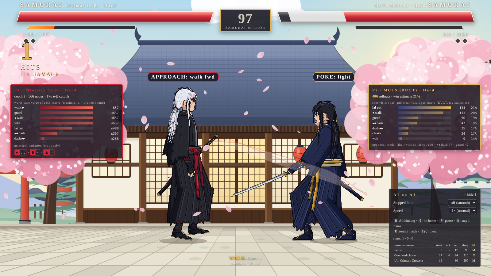
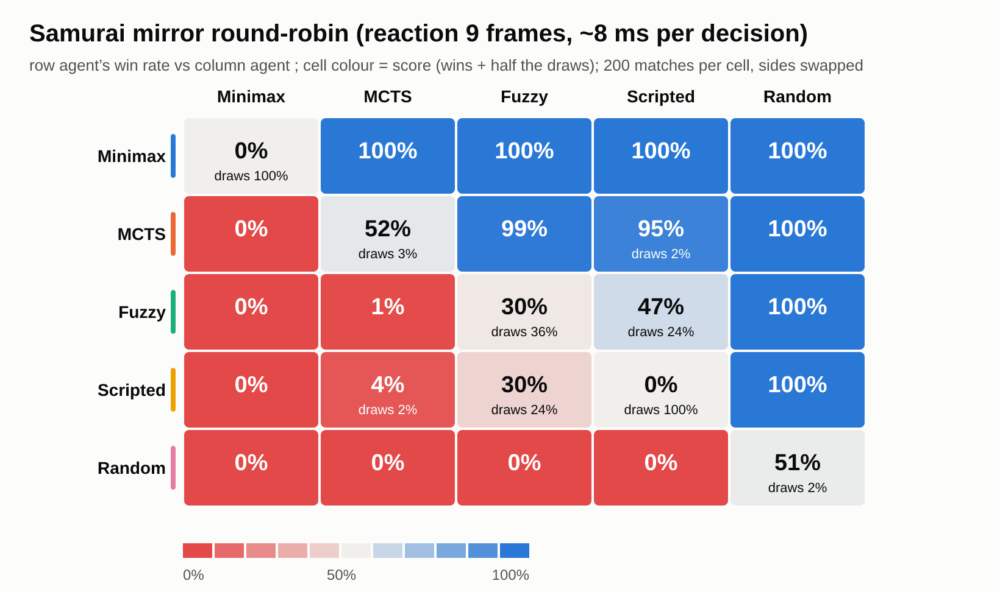

# Samurai vs Samurai: one fighter, different minds

**CSE 3210 Artificial Intelligence Laboratory: term project report (AI part).**
Game: *Shinobi Arena*, a 2D real-time fighting game in which each fighter's personality is an AI algorithm.

The experiment is a **mirror match**: both fighters are the same Samurai, with the same moves, frame data, hit boxes and
damage. Any difference in results therefore comes from the algorithm, not from the character. Three fundamentally
different AIs control him: adversarial search (Minimax with alpha-beta), Monte Carlo tree search (decoupled UCT), and
fuzzy logic (Mamdani inference). A genetic algorithm tunes Minimax's evaluation function. Two baselines (random,
scripted) anchor the scale.

Measured results are in [`ai_benchmark.md`](ai_benchmark.md); the build plan is [`../game/AI_PLAN.md`](../game/AI_PLAN.md).

## Results in one paragraph

In 3,000 Samurai-vs-Samurai matches at equal thinking time (about 8 ms per decision, 9-frame reaction for everyone),
**Minimax won every match against MCTS, Fuzzy and Scripted (200/200 each, 95 % CI 98–100 %)**. It did so by playing
footsies: it waits just outside the iai cut's reach, blocks, and counter-hits the recovery. **MCTS** is clearly
second: it beats Fuzzy 99 % and Scripted 95 %, and its mirror is 51.5 / 46.0. **Fuzzy** beats Random and edges
Scripted, but never beats a searcher. Two Minimax copies **never attack each other** (100 % equal-HP time-outs), a
textbook property of maximin; with Normal-level mistakes that mirror splits 56 / 43. Scaling curves show MCTS
improving smoothly with rollouts (5 % → 98 % vs a 300-node Minimax), while Minimax jumps from 0 % to 100 % once depth 2
completes. The GA nearly doubled Minimax's fitness under its own protocol (0.52 → 0.98) but overfitted to its panel.

## 1. How the requirements are met

| # | Requirement | Where |
|---|---|---|
| R1 | Two or more fundamentally different AIs | `game/src/ai/minimax.js` (search), `mcts.js` (sampling), `fuzzy.js` (rules); GA tuning in `game/tools/ga_tune.mjs` |
| R2 | AI vs AI mode with benchmark data | headless `game/tools/arena.mjs` (round-robin, 200 matches per pairing, Wilson CIs); on-screen AI vs AI from the menu |
| R3 | Human-playable mode with difficulty levels | menu → *Human vs AI*; `game/src/ai/difficulty.js`: Easy / Normal / Hard / Master |
| R4 | Polished visuals that show each AI's thinking | `game/src/overlay.js`: per-fighter panel (values / visits / rule activations, principal variation) and an intent label above each head |

Lab topics covered: **Lab 04** adversarial search (minimax, alpha-beta, evaluation functions, horizon effect),
**Lab 08** Monte Carlo tree search (UCB1, the four phases, a simultaneous-move variant), **Lab 05** fuzzy logic
(linguistic variables, membership functions, Mamdani rule base, centroid defuzzification), **supplementary** genetic
algorithms (tournament selection, crossover, mutation, fitness design).

## 2. The game as a search problem

**Simulator.** `game/src/sim.js` is a deterministic 60 Hz state machine: its only input is one button bitmask per
fighter per frame, and it never renders or draws random numbers. That makes it a perfect forward model: an agent can
copy the state (`sim.clone()`, about 0.35 µs) and play hypothetical futures (`step()`, about 0.5 µs per frame for the
Samurai mirror, about 2 M frames per second).

**The Samurai.** He can walk, dash forward, back-dash along the ground, stand-guard, and use three attacks:
*iai cut* (light, mid, 29 frames, 90 damage, reach about 1,060 units: very long), *overhead cleave* (heavy, 46 frames,
210 damage, overhead, knockdown, 25 % chip through a block) and the *Crimson Crescent* ultimate (full meter, a ground
wave dealing 500, 175 chip when blocked). He cannot jump, crouch or run: the simulator masks those buttons for him.

**Macro-actions.** Searching over raw buttons at 60 Hz is pointless (2^11 inputs per frame). Agents choose among
9 *macro-actions*, short committed input programs: `wait`, `walk_fwd`, `walk_back` (8 frames each), `dash_fwd`,
`dash_back`, `guard` (8 frames, held through blockstun), `light`, `heavy`, `ult` (press, then neutral until the move
ends). A fighter decides only when it is free and its previous macro has finished. While it is committed (attacking,
dashing, stunned, knocked down) it has exactly one action. A legality filter removes pointless macros (attacks far
outside reach, the ultimate without meter, retreating into the wall). In practice a decision has 5 to 9 options,
taken roughly every 8 to 30 frames.

**Simultaneity.** Both fighters choose at the same moment and neither sees the other's choice. This is the main
algorithmic difficulty and the main thing the three agents handle differently (section 4).

**Fair play rules (enforced, not promised).**
- Agents never see the live simulator. Each gets a *view*: a clone of the state `reactionFrames` ago in which the
  opponent's input state (buffered presses, previous buttons, double-tap timers, held flags) is wiped.
  `assertSanitised` checks every view in every match.
- An agent extrapolates its stale view to "now" by stepping it with the inputs it sent itself (which it knows) and a
  guess for the opponent made only from what is visible (a walking fighter keeps walking).
- All randomness comes from a seeded mulberry32 PRNG. In node / rollout budget mode a whole match replays
  bit-identically, and the browser can replay any arena match and verify every 60th frame's state hash.

## 3. The agents

### 3.1 Minimax with alpha-beta: the disciplined duelist (Lab 04)

At a node where both fighters can act, the value is computed as **maximin**:

    V(node) = max over my macros a ( min over their macros b ( V(child(a, b)) ) )

A child is produced by cloning the state and playing both macros forward until the next decision point of *either*
side (cap 40 frames). A side whose macro is still running has only "continue" in that child, so the tree naturally
mixes joint nodes, max-only and min-only nodes. At the depth limit both running macros are played to their end
("settled", a quiescence-style extension, so a committed swing is valued by its outcome, not mid-air) and the state is
scored by the evaluation function.

- **Alpha-beta.** Inside a row (my macro fixed) the loop over replies stops as soon as the row cannot beat the best row
  found so far (`row <= max(alpha, best)`). Across rows the loop stops when `best >= beta`. Windows are passed to
  children. On fixed test positions alpha-beta returns exactly the plain maximin value and move while expanding about
  90 % fewer nodes (`game/tools/test_agents.mjs`).
- **Move ordering:** the previous iteration's best first, then attacks that reach, the ultimate, guard, movement, wait.
  At the root, ties are broken with the seeded RNG.
- **Iterative deepening** under a node budget (benchmarks) or a time budget (game), and a **transposition table** keyed
  by `sim.hash()`, the running programs and the depth.
- **Evaluation** (`eval.js`, weights in one object): HP difference; meter difference with a bonus for a full bar;
  distance error against the light's reach; commitment (frames locked in recovery while the opponent could reach);
  a whiffed heavy; corner pressure; knockdown advantage; incoming projectile threat; a large KO term.

**Why maximin is pessimistic, and why that suits this character.** Maximin lets the opponent choose *after* seeing my
choice, which a real opponent cannot do. The value it computes is therefore a guaranteed floor (a *security level*),
not the game's equilibrium value; with mixed strategies the true value is at least as high. A maximin player never
takes an action whose worst case is bad. For a duelist built around one long, slow sword that is the right temperament:
stand just outside the opponent's reach, let them commit, and punish the recovery.

### 3.2 Monte Carlo tree search, decoupled UCT: the improviser (Lab 08)

MCTS samples instead of enumerating. For the simultaneous moves it uses **decoupled UCT (DUCT)**: every node keeps
separate statistics per player, `N_i(a)` and `W_i(a)`, and in selection each player picks independently with UCB1
over its own statistics:

    a_i = argmax_a  W_i(a) / N_i(a) + c * sqrt( ln n / N_i(a) )

The joint pair indexes the child, and neither player's choice depends on the other's. The four phases:

1. **Selection** descends with decoupled UCB1 while the joint child exists.
2. **Expansion** creates the missing child (clone, both macros to the next decision point).
3. **Simulation** runs a 60-frame rollout in which both sides pick random legal macros. The policy has two "instinct"
   biases: guard against a visible attack startup, and punish a visible whiff. The result is scored by the same
   `eval.js`, squashed to [0, 1].
4. **Backpropagation** updates every node on the path: `N_me(a) += 1, W_me(a) += r; N_op(b) += 1, W_op(b) += 1 - r`.

The final move is the root macro with the most visits. The overlay shows rollouts, visits and the mean result per
macro, and the opponent model (which of *their* macros the search expects).

**Tuning (measured; see `ai_benchmark.md` §5).** The textbook `c = √2` failed here. Rewards are squashed evaluations, and
sensible macros differ by only 0.02 to 0.1, so a large `c` spreads visits almost uniformly. `c = 0.1` with 60-frame
rollouts raised the win rate against the scripted baseline from 20 % to 97.5 %.

### 3.3 Fuzzy logic, Mamdani: instinct without search (Lab 05)

No look-ahead at all. Each decision fuzzifies the situation into linguistic variables:

| variable | sets |
|---|---|
| distance (gap to the opponent's body ÷ light reach) | close (inside the reach), mid (the footsie edge), far |
| own HP, opponent HP (fraction) | low, mid, high |
| meter | empty, partial, full |
| opponent state (from the visible animation) | attacking, recovering, neutral |

Sixteen readable rules, for example *IF opponent recovering AND distance mid THEN aggression very high (punish with
heavy)*, or *IF own HP low AND opponent HP high THEN defence high*. AND is `min`, each rule clips its output set
(`min` implication), rules aggregate with `max`, and **centroid defuzzification** gives two crisp numbers, aggression
and defence on [0, 1]. A small deterministic table, with the seeded RNG only for footsie variety, maps them to a macro.
At the footsie edge, for example, it pokes the approach or re-spaces. The overlay shows every membership degree, the
three strongest rules and the aggression meter.

### 3.4 Genetic algorithm: tuning the evaluation (supplementary)

`game/tools/ga_tune.mjs` evolves Minimax's evaluation weights (9 genes, each in [0, 3 × default]). Each candidate is
scored by self-play in the mirror against a fixed panel (the hand-tuned Minimax, a small-budget MCTS, Fuzzy) in
deterministic budget mode. Fitness is the win score plus 0.25 × HP margin. The margin term is necessary: a
pessimistic mirror often ends in equal-HP time-outs, which makes the landscape flat. The operators are tournament
selection (k = 3), BLX-0.3 blend crossover, Gaussian mutation (p = 0.3, σ = 15 % of the range) and elitism 2;
16 genomes for 15 generations.

### 3.5 Baselines

*Random* picks a uniform legal macro. *Scripted* is a five-line policy: walk in, light in range, guard when the
opponent swings, heavy on a whiff. Every real agent must beat Random by more than 90 %.

## 4. Simultaneous moves: the three answers

| | how it treats "both choose at once" | consequence measured in the mirror |
|---|---|---|
| Minimax | maximin: pretend the opponent sees my move and best-responds | a guaranteed floor; never takes a risky poke; blocks 13–25 enemy attacks per match; deadlocks against itself |
| MCTS (DUCT) | each player has its own bandit at every node; the joint outcome is sampled | an average over plausible replies; optimistic about pokes that a best-responder would punish (19 of its attacks per match are blocked by Minimax) |
| Fuzzy | no model of the reply at all; reacts to what is on screen | cheapest by far (0.02–0.06 ms per decision), readable, beaten by any look-ahead |

Exact solutions (a mixed-strategy Nash equilibrium per node via linear programming or regret matching) would remove
maximin's pessimism. They are listed below as the natural next step.

## 5. Benchmark results (summary; full tables in [`ai_benchmark.md`](ai_benchmark.md))

| pairing (200 matches each, sides swapped) | result |
|---|---|
| Minimax vs MCTS / Fuzzy / Scripted / Random | 100 % / 100 % / 100 % / 100 % (HP margin 82 / 85 / 100 / 88 %) |
| MCTS vs Fuzzy / Scripted / Random | 99.0 % / 95.0 % / 100 % |
| Fuzzy vs Scripted / Random | 46.5 % (30.0 % lost, 23.5 % draws) / 100 % |
| Self-mirrors | MCTS 51.5 / 46.0 · Random 50.5 / 47.5 · Fuzzy 30.0 / 34.5 (35.5 % draws) · Minimax 100 % draws (time-outs) · Minimax at Normal 56 / 43 (100 matches) |
| Budget scaling | Minimax vs MCTS-250: 0 % at ≤150 nodes, 26 % at 300, 100 % at 600 and 1,200 · MCTS vs Minimax-300: 5 / 21 / 41 / 76 / 91 / 98 % at 30–1,000 rollouts |
| GA-Minimax | 100 % against MCTS, Fuzzy, Scripted, Random; draws Minimax 100 %; better margins vs MCTS, worse vs Scripted (overfitting) |

What the results show:
1. **At equal compute, pessimistic search beats sampling** in this game. The Samurai's main poke is long and slow, so
   whiffs are punished hard, and maximin never whiffs (0.01 heavy whiffs per match against MCTS's 1.4–1.8).
2. **MCTS degrades gracefully, Minimax falls off a cliff.** With less than a few hundred nodes Minimax cannot see the
   reply to its reply and loses every match to MCTS. With more time MCTS gets steadily stronger, but even at 4× the
   time it does not overturn a depth-2 Minimax (0 / 40).
3. **Sanity holds.** Every agent beats Random 100 %, non-deterministic mirrors are near 50 %, and P1/P2 rates agree,
   so the simulator and arena have no side bias.

## 6. Difficulty design

| level | thinking budget | reaction delay | mistakes | notes |
|---|---|---|---|---|
| Easy | 2 ms (Minimax 150 nodes, MCTS 60 rollouts) | 22 frames | 20 % | |
| Normal | 8 ms (600 / 240) | 14 frames | 8 % | |
| Hard | 16 ms (1,200 / 480) | 9 frames | 2 % | the benchmark's reaction delay |
| Master | 50 ms in a Web Worker (3,750 / 1,500) | 6 frames | 0 % | measured in the browser: depth 3, about 1,600 nodes per 50 ms decision |

A mistake replaces the chosen macro with a random legal one (shown in red in the overlay). Against a proxy human (the
scripted policy with a 250 ms reaction and 10 % mistakes) the levels are ordered for MCTS (23 → 85 → 98 → 100 % AI
wins) and Fuzzy (23 → 45 → 43 → 43 %). Minimax is already 93 % on Easy. **A real human play-test is still to be done**:
I could only test with scripted input, so whether Easy Minimax is too hard for people is open. The levels are one
table in `game/src/ai/difficulty.js`.

## 7. Limitations

- **Maximin deadlock.** Two Minimax agents at zero mistakes never fight. Time pressure in the evaluation, or a
  mixed-strategy root (regret matching / LP), would fix it; the GA cannot.
- **The Samurai's very long light** (measured reach about 1,060 units, from the art) makes the mirror a pure spacing
  game. That is faithful to the art package; a shorter blade would change the balance (README balance note).
- **Benchmarks are at one budget (about 8 ms).** The scaling curves show that the ranking between Minimax and MCTS
  flips at small budgets.
- **The GA panel was small** (3 opponents, 12 short matches per genome), and the evolved weights overfit (worse than
  the defaults against Scripted).
- **No real human play-test** (see §6). Master's worker latency adds a few frames of reaction in the browser.
- **Data fix outside `game/`**: the crescent's height (y 0..420 → 0..300) in `art/samurai/samurai.moves.js`, so it can
  be jumped; documented in `art/samurai/README.md`, and `npm run all` still ends with `all checks passed`.

## 8. Acceptance checklist (prompt 05 §8)

- [x] **Shinobi vs Shinobi replay hash identical before and after the refactor.** `node game/tools/replay_hash.mjs check`
  → `3600 / 3600 frames identical (final 39e93813 = baseline 39e93813)`; baseline recorded on the original code.
  Also verified on the project owner's PC.
- [x] **Samurai fully playable.** `node game/tools/test_samurai.mjs`, 25 checks: W/S/K/I masked, double-tap forward does
  not run, grounded back-dash (22 frames, height 0), light mid 90, heavy overhead 210 with knockdown and 53 chip,
  crescent 500 / 175 chip, not avoided by crouching, jumpable with timing, mixed matches. Screenshots:
  `docs/img/stage1_samurai_moves.png`.
- [x] **`sim.clone()` / `hash()` / headless.** `node game/tools/test_clone.mjs`: 3 × 3,000 lock-step frame hashes equal;
  `clone()` 0.35 µs vs `structuredClone` 17 µs (48× cheaper); 2.2 M frames/s for the Samurai mirror.
- [x] **Three fundamentally different agents** on the same Samurai data: Minimax + alpha-beta (alpha-beta = plain
  maximin on 24 position checks, 90 % fewer nodes), MCTS / DUCT, Fuzzy (16 rules, documented rules fire:
  `game/tools/test_agents.mjs`).
- [x] **Delayed, sanitised views; no peeking; seeded randomness.** Asserted in every match; the test shows that a leaking
  view is rejected, that agents never receive the live sim, and that matches with the same seeds (including reaction
  delay and mistakes) replay bit-identically.
- [x] **Arena round-robin.** 200 matches per pairing, sides swapped, Wilson CIs; non-deterministic self-mirrors near 50 %
  (the deterministic Minimax and Scripted mirrors are 100 % draws, explained, and a Normal-level Minimax mirror is
  56 / 43); every agent 100 % vs Random. [`ai_benchmark.md`](ai_benchmark.md).
- [x] **On-screen AI vs AI with thinking overlays; Human vs AI with 4 levels.** `docs/img/ai_vs_ai_overlay.png`,
  `docs/img/ai_vs_ai_minimax_vs_mcts.gif`, `docs/img/human_vs_ai_fuzzy.png`; Master verified running in a Web Worker.
- [x] **Arena replays play back bit-identically in the browser.** `game/replays/demo_minimax_vs_mcts.json` (from
  `arena.mjs --replay 4`): 27 / 27 checks identical (25 frame-hash checkpoints and 2 round ends), including the
  browser's K.O. and intro frames.
- [x] **`docs/ai_report.md` and `docs/ai_benchmark.md` written from measured data.**

Decision logs with each agent's reasoning: `docs/decision_log_minimax_vs_mcts.txt`, `docs/decision_log_fuzzy_vs_scripted.txt`.

