<div align="center">

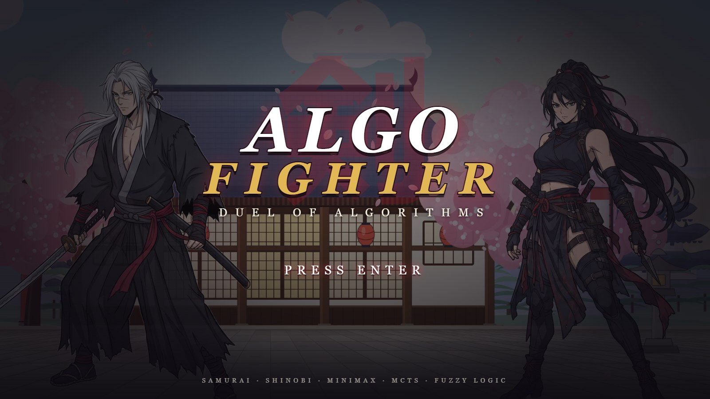

# ⚔️ ALGO FIGHTER

### *Duel of Algorithms*: a 2D fighting game where the fighters are AI algorithms

**[▶ PLAY IT NOW: algo-fighter.vercel.app](https://algo-fighter.vercel.app)**

📄 [Project report (PDF)](paper/Algo_Fighter_Report.pdf) · 🎞 [Presentation (PDF)](paper/Algo_Fighter_Presentation.pdf) · [slides with animations (.pptx)](paper/Algo_Fighter_Presentation.pptx)

Runs in any modern browser · desktop, phone and tablet · no install, no build step


*CSE 3210 · Artificial Intelligence Laboratory · Khulna University of Engineering & Technology (KUET)*

</div>

---

<div align="center">
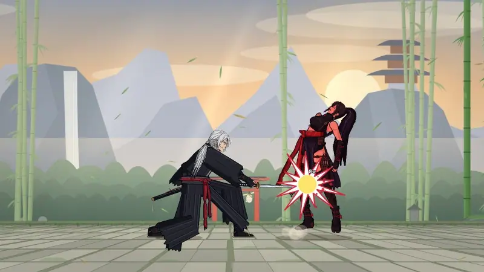
<br><sub><b>Minimax</b> (Samurai, left) vs <b>MCTS</b> (Shinobi, right): every input in this clip was chosen by the two search algorithms.</sub>
</div>

---

## What is this?

**Algo Fighter** is a real-time 2D fighting game built as an AI-lab project. In most games the AI is hidden behind the
character. Here **the AI is the character**:

| Fighter | Mind | Personality |
|---|---|---|
| **Samurai**: ronin, heavy duelist | **Minimax** with alpha-beta pruning | Disciplined and pessimistic. Never takes a risk whose *worst case* is bad; waits at the edge of his huge reach and punishes every whiff. |
| **Shinobi**: assassin, frontline fighter | **Monte Carlo Tree Search** (Decoupled UCT) | An improviser. Samples thousands of possible futures and plays what *usually* works: fast, evasive, willing to gamble. |
| *either fighter* | **Fuzzy logic** (Mamdani inference) | Pure instinct: 16 human-readable rules and no look-ahead at all. |

Any algorithm can drive any fighter at four difficulty levels. You can **fight them yourself**, **watch two algorithms
fight each other**, or **replay a recorded match** that is re-simulated bit for bit. While they fight, a live overlay
shows **what each algorithm is thinking**: the moves it considered, their values or visit counts, and the one it picked.

---

## Contents

- [Features at a glance](#-features-at-a-glance)
- [The fighters](#-the-fighters)
- [Screens](#-screens)
- [Time of day & weather](#-time-of-day--weather)
- [The AI: how the game becomes a search problem](#-the-ai-how-the-game-becomes-a-search-problem)
- [How Minimax plays](#-how-minimax-plays-the-samurai)
- [How MCTS plays](#-how-mcts-plays-the-shinobi)
- [Minimax vs MCTS, side by side](#-minimax-vs-mcts-side-by-side)
- [Fuzzy logic and the genetic algorithm](#-the-other-minds-fuzzy-logic--a-genetic-algorithm)
- [Reading the AI-thinking overlay](#-reading-the-ai-thinking-overlay)
- [Benchmarks](#-benchmarks)
- [Difficulty levels](#-difficulty-levels) · [The Master level](#-the-master-level-thinking-one-move-ahead)
- [Controls](#-controls)
- [Playing on a phone](#-playing-on-a-phone)
- [Architecture](#-architecture)
- [Run it locally](#-run-it-locally) · [Tests](#-tests) · [Deploy](#-deploy)
- [Report & presentation](#-report--presentation) · [References](#-references)

---

## ✨ Features at a glance

- **Two hand-built fighters** with full movesets: walks, dashes, jumps, normals, chains, projectiles, parries, a
  log-substitution counter (*Kawarimi*), a shockwave repel, guard gauges, knockdowns and two cinematic **ultimates**.
- **Three AI families** (adversarial search, Monte Carlo sampling, fuzzy inference) plus a genetic algorithm that tunes the
  Minimax evaluation and two baselines (random, scripted).
- **Live "thinking" overlay**: per-AI cards with ranked options, search statistics and the chosen move, plus a speech bubble
  over each fighter's head.
- **Fair AI**: agents see a *delayed* (reaction-time) and *sanitised* copy of the game; they can never read your inputs.
- **Deterministic 60 Hz simulation**: the same inputs always produce the same match, so replays are verified frame
  by frame against state hashes.
- **Game modes**: Versus CPU · CPU vs CPU · Training (frame data, hit boxes, dummy modes) · Replay.
- **Two stages** (Cherry Temple, Bamboo Mountain) with parallax layers and **per-round time of day and weather**: clear sky,
  morning mist, golden dusk, moonlit night, rain, thunderstorm and snow.
- **Full front end**: title, character select with live palette-swapped models, stage select, VS screen, options, pause and
  result menus, music and sound effects.
- **Mobile ready**: touch controls you can rearrange, layouts for any aspect ratio (phones, tablets, ultrawide), and
  installable as an app (PWA).

---

## 🥷 The fighters

<table>
<tr>
<td width="50%" align="center"><br><b>SAMURAI</b> · <i>Ronin · Heavy Duelist</i></td>
<td width="50%" align="center"><br><b>SHINOBI</b> · <i>Assassin · Frontline Fighter</i></td>
</tr>
<tr>
<td valign="top">

Patient iaido swordsman with an enormous reach. He **cannot jump, crouch or run**: his strength is spacing.

- **Iai cut**: a long, fast mid draw-cut, his main poke
- **Stepping thrust**: a lunging gap closer
- **Overhead cleave**: slow, heavy, breaks crouch-guard, knocks down
- **Parry**: tap guard as a kunai arrives to deflect it
- **Repel**: guard + light, a blade shockwave that shoves her away, usable even while being hit
- **Ultimate · Crimson Tempest**: three blade waves (high, low, tall). A clean hit starts an ink-wash cinematic.

</td>
<td valign="top">

Fast and slippery: walks, **runs**, jumps, back-hops, crouches and throws kunai.

- **Light sword → kick → slash → kunai**: normals chain upwards on hit
- **Air moves**: dive stab, flying kick; low stab and sweep
- **Kawarimi**: guard + light. If a sword hits the seal she leaves a log behind and strikes from behind; it is also an escape.
- **Ultimate · Kage Bunshin**: three ink shadow-clones (air kick, sword slash, a fury of kunai from behind). Any hit starts the moonlit **Shadow Execution**.

</td>
</tr>
</table>

<table>
<tr>
<td width="50%">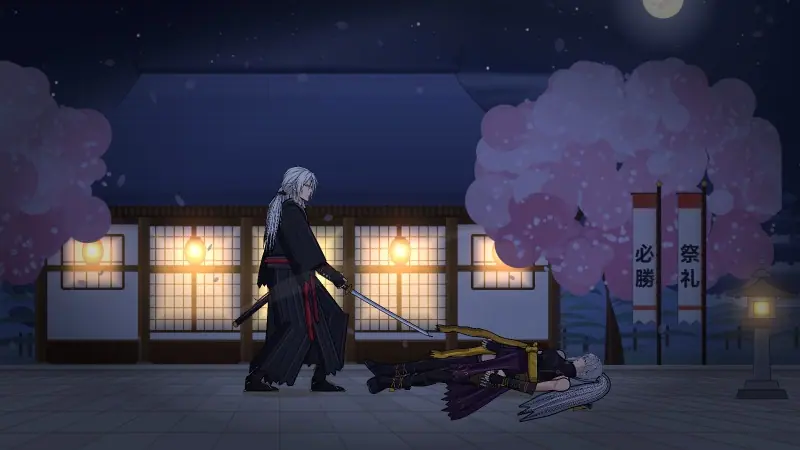<br><sub><b>Crimson Tempest</b>: the waves connect, the world drains to sumi-e ink, and the finishing stroke lands.</sub></td>
<td width="50%">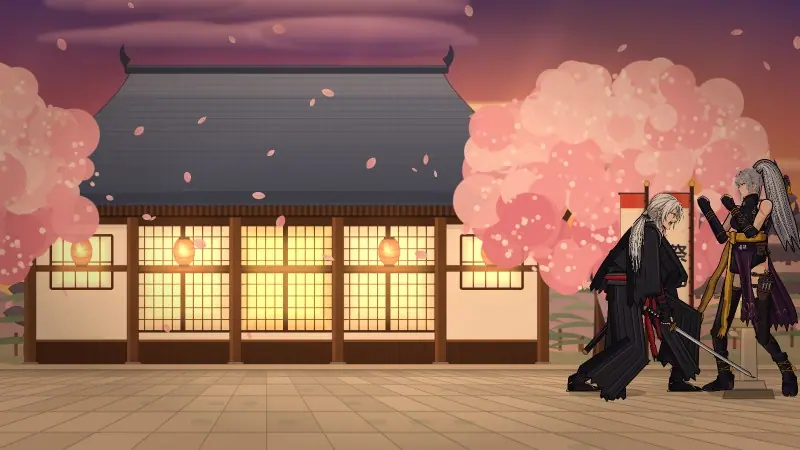<br><sub><b>Kage Bunshin</b>: the shadow clones strike, then the moonlit Shadow Execution.</sub></td>
</tr>
</table>

> Both clips are real gameplay, recorded from the bundled replay `game/replays/demo_samurai_vs_shinobi.json`
> (MCTS vs MCTS). Both ultimates were cast by the AI.

---

## 🖼 Screens

| Character select | Stage select |
|---|---|
| 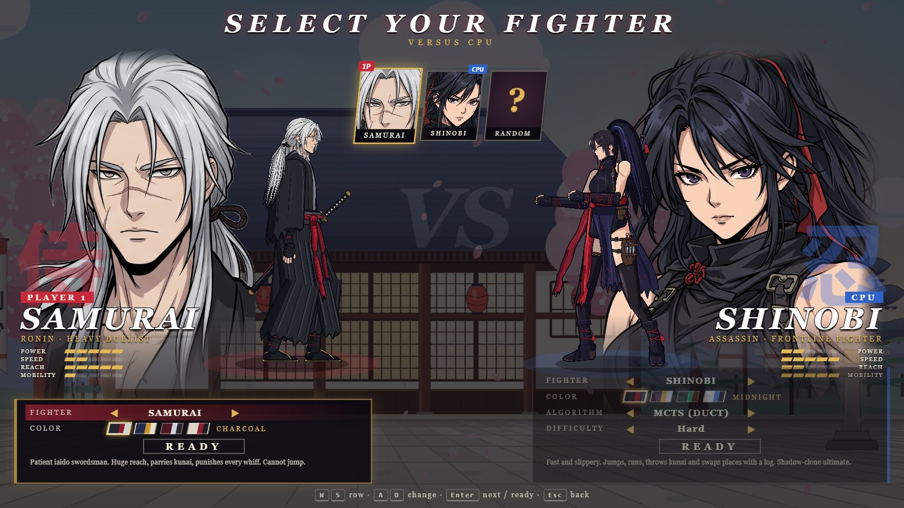 | 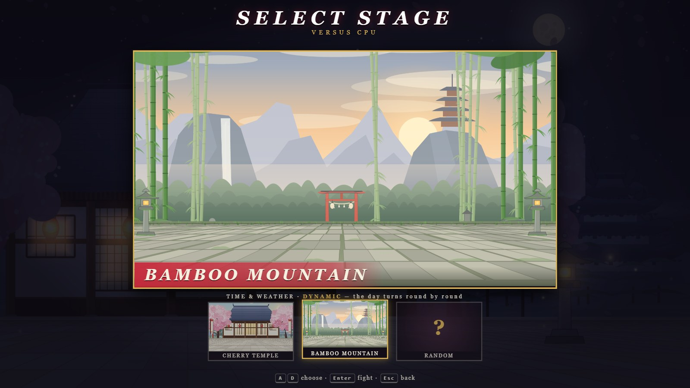 |
| Pick a fighter, one of 4 colour palettes, and for each CPU its **algorithm** and **difficulty**. The models are the real in-game rigs, live. | Two stages, or random. The time and weather setting applies to every stage. |

<div align="center">
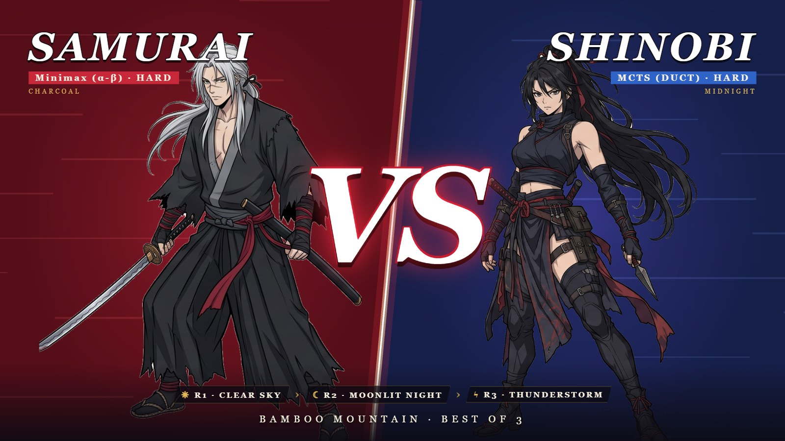
<br><sub>The VS screen names each fighter's algorithm and shows the <b>forecast</b>: the time of day / weather for each round.</sub>
</div>

---

## 🌦 Time of day & weather

The fights look the same in every way that matters for gameplay (the weather is **purely cosmetic**; the simulation
never sees it), but every round can look different. With the default **Dynamic** setting the day turns as the match goes
on: **round 1 in daylight, round 2 at dusk or night, round 3 brings a storm, rain or snow**. The new sky cross-fades in
while *ROUND 2* is announced.

<div align="center">
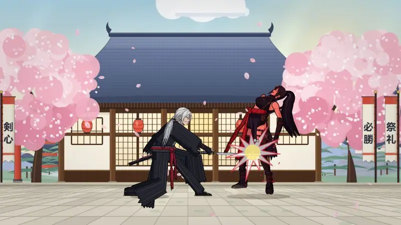
<br><sub>One fight, seven conditions: clear sky → golden dusk → moonlit night → thunderstorm → first snow → morning mist → rain.</sub>
</div>

<table>
<tr>
<td width="50%">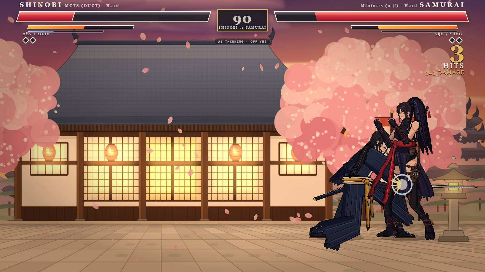<br><sub><b>Golden dusk</b>: warm grading, low sun, god rays, lanterns lighting up</sub></td>
<td width="50%">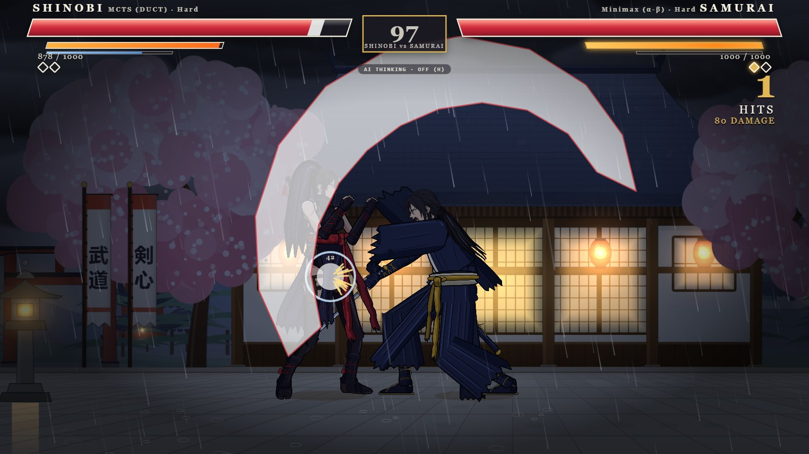<br><sub><b>Thunderstorm</b>: slanted rain, splashes, a wet floor reflecting the lanterns, lightning with thunder</sub></td>
</tr>
<tr>
<td>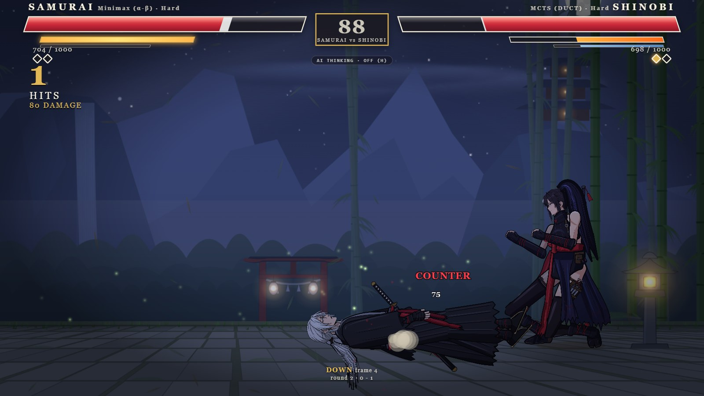<br><sub><b>Moonlit night</b> on Bamboo Mountain: stars, moon, fireflies, lit shrine lamps and pagoda windows</sub></td>
<td>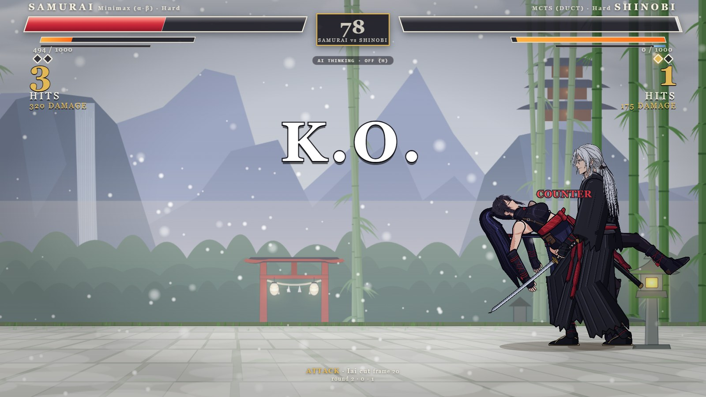<br><sub><b>First snow</b>: drifting flakes and a snow-dusted floor</sub></td>
</tr>
</table>

How it works (`game/src/atmosphere.js`): every condition is a set of numbers (a colour **tint per depth band**
(sky / far / mid / near / floor / fighters), haze, glow, rain, snow, wind, lightning, vignette, wet floor, snow cover)
and a change of weather simply interpolates between two such sets. Light sources (lanterns, shoji windows, pagoda windows)
are listed in each stage's `stage.json` and glow as additive sprites at dusk and night. Particles, painted skies and
thunder are all generated in code; no video or audio files are involved.

---

## 🧠 The AI: how the game becomes a search problem

### 1 · A perfect forward model

The simulation (`game/src/sim.js`) is a **deterministic 60 Hz state machine**. Its only input is one button bitmask per
fighter per frame. It never draws random numbers and never touches the renderer. That makes it a *perfect model of the
game*: an AI can copy the current state (`sim.clone()`, ≈ 0.35 µs) and play out hypothetical futures (`step()`, around
**2 million frames per second**). Both search algorithms are built on exactly this ability: *"what happens if I do X and
they do Y?"*

### 2 · Macro-actions instead of buttons

Searching over raw buttons is hopeless: 2¹¹ possible inputs, 60 times a second. Instead every agent chooses among
**macro-actions**, short committed input programs such as `walk_fwd` (8 frames), `dash_back`, `guard`, `light` (press,
then neutral until the move ends), `thrust`, `heavy`, `kunai`, `kawarimi`, `ult`, a full chain
`iai→thrust→cleave`, or situational ones like *"parry in 3 frames"* that are legal only while a projectile is incoming.

A fighter makes a **decision** only when it is free (idle, walking, guarding) and its previous macro has finished. While
committed (attacking, dashing, stunned) it has exactly one option: *continue*. A legality filter removes pointless
choices (attacks far out of reach, the ultimate without meter, retreating into a wall), so a typical decision has
**5 to 9 options**, made every **8 to 30 frames**.

### 3 · Both players move at the same time

This is the heart of the problem. Unlike chess, **both fighters choose simultaneously**, and neither sees the other's
choice. Minimax and MCTS answer this in opposite ways, and that difference is their personality.

### 4 · Fair play, enforced in code

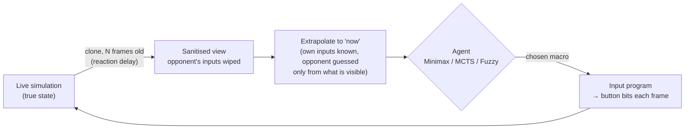

- Agents **never** see the live simulation, only a **clone from `reactionFrames` ago** (6 to 22 frames depending on
  difficulty) in which the opponent's buffered presses, held buttons and input timers are wiped. `assertSanitised`
  checks every single view in every match.
- All randomness comes from a **seeded PRNG** (mulberry32), so in benchmark mode a whole match replays bit-identically.

### 5 · One evaluation function

Both search algorithms score a position with the same hand-written function (`game/src/ai/eval.js`):

| Term | Meaning |
|---|---|
| **HP difference** | the obvious one |
| **Meter**, **full-bar bonus** | ultimate resource; a live ultimate in flight keeps its value |
| **Spacing** | distance error against the ideal poke range |
| **Commitment** | frames I am locked in recovery while the opponent could reach me |
| **Whiffed heavy** | punishable recovery |
| **Corner pressure**, **knockdown advantage** | positional terms |
| **Projectile threat** | incoming kunai / waves |
| **K.O.** | a very large term |

---

## ♟ How Minimax plays the Samurai

> *"Only take an action whose **worst** outcome is acceptable."*

### Turning a simultaneous game into maximin

At a node where both fighters can act, the Samurai assumes the worst: he picks his macro **first**, and the opponent
answers **knowing** that choice:

$$
V(\text{node}) \;=\; \max_{a\,\in\,\text{my macros}} \;\; \min_{b\,\in\,\text{their macros}} \; V\big(\text{child}(a, b)\big)
$$

This is **maximin**, a *security level*: whatever the opponent really does, the outcome is at least this good. A real
opponent can't see his choice, so the true value of the position is even higher. Maximin is **pessimistic on purpose**,
and that suits a duelist with one long, slow sword: stand just outside the enemy's reach, let them commit, punish the
recovery.

### The search tree

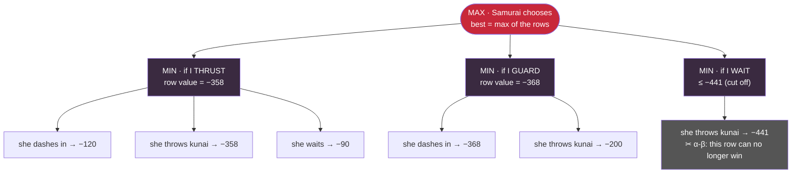

<sub>Illustrative numbers in the style of the in-game overlay (the evaluation function's score for the Samurai). THRUST wins: its worst case (−358) beats GUARD's (−368); WAIT's first reply already scores −441, below the best row, so its other replies are never searched.</sub>

How a child is produced: **clone the state, start both macros, and play the simulation forward** until the next moment
*either* fighter can decide again (capped at 40 frames). If one side is still mid-move, that node has only one action for
it ("continue"), so the tree naturally mixes joint nodes, max-only nodes and min-only nodes.

### What makes it fast enough for 60 fps

| Technique | What it does here |
|---|---|
| **Alpha-beta pruning** | Inside a row (my macro fixed) the reply loop stops as soon as the row can no longer beat the best row so far; across rows the loop stops when `best ≥ β`. On fixed test positions it returns *exactly* the plain-maximin value and move while expanding **≈ 90 % fewer nodes**. |
| **Move ordering** | Previous iteration's best first, then attacks that reach, the ultimate, guard, movement, wait. Good ordering makes pruning cut early. |
| **Iterative deepening** | Depth 1, 2, 3 … until the time budget (or node budget in benchmarks) runs out; depth 1 always completes. |
| **Transposition table** | Keyed by `sim.hash()` + the running macro programs + depth, so repeated positions are not searched twice. |
| **"Settled" leaves** | At the depth limit both running moves are played to their end before scoring (a quiescence-style extension), so a committed swing is valued by its *result*, not frozen mid-air. |

### Its signature behaviour

Minimax **never gambles on a read**. In benchmarks it whiffs a heavy attack 0.01 times per match (MCTS 1.4 to 1.8), blocks
13 to 25 enemy attacks per match, and wins by **footsies**. The flip side is a textbook property of maximin: two Minimax
Samurai at zero mistakes **never attack each other** (100 % equal-HP time-outs), because for each one *any* attack has a
worse worst case than waiting.

**The fix: impatience (the Hurwicz criterion).** When no damage has landed for about 2 seconds, the root stops valuing a
move by its worst reply alone and blends in its average reply,

$$
V_\lambda(a) \;=\; (1-\lambda)\,\min_b V(a,b) \;+\; \lambda \cdot \operatorname{mean}_b V(a,b),
$$

with $\lambda$ ramping from 0 to 0.5 the longer the standoff lasts (near-equal moves become a seeded coin flip, so two
identical searchers stop mirroring each other). Below the root the search stays exact maximin with alpha-beta, and with
no stalemate ($\lambda = 0$) nothing changes. Result: the Master Minimax mirror went from **0 hits and 100 % time-outs**
to about **40 hits per match, decided by K.O.**

---

## 🎲 How MCTS plays the Shinobi

> *"Don't prove what's best; **sample** what usually works."*

Monte Carlo Tree Search builds its tree by **playing thousands of quick, random-but-sensible futures** and growing the
tree towards the promising ones. Because both fighters move at once, it uses **Decoupled UCT (DUCT)**: every node keeps
**separate statistics for each player**, so each picks its move *without* seeing the other's.

### The four phases, repeated thousands of times per decision

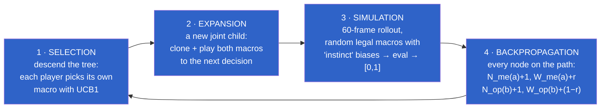

**1 · Selection with decoupled UCB1.** At each node, player *i* independently picks

$$
a_i \;=\; \arg\max_{a}\; \underbrace{\frac{W_i(a)}{N_i(a)}}_{\text{how good it has been}} \;+\; c\,\underbrace{\sqrt{\frac{\ln n}{N_i(a)}}}_{\text{how unexplored it is}}
$$

and the **pair** $(a_0, a_1)$ indexes the child. Neither choice depends on the other's, which is exactly the
information structure of a simultaneous move.

**2 · Expansion.** The first time a joint pair is tried, its child is created by cloning the state and playing both macros
forward to the next decision point (the same forward model Minimax uses).

**3 · Simulation (rollout).** From the new node, both fighters play **60 frames** of random legal macros, with three
*instinct* biases any real fighter has, so the rollouts aren't absurd:
guard against a visible attack startup (55 %), punish a visible whiff (70 %), defend against an incoming projectile
(60 %). The final state is scored by `eval.js` and squashed to a reward $r \in [0, 1]$.

**4 · Backpropagation.** Every node on the path updates both players' statistics: the Shinobi's macro gets $r$, the
opponent's gets $1 - r$ (a zero-sum game).

**The final move** is the root macro with the **most visits** (more robust than the highest mean). The overlay shows
exactly that: rollouts, visits per macro, the mean result, the estimated **win %** and the *opponent model*, meaning
which replies the search expects from the Samurai.

### A finding from tuning: the textbook constant fails

The textbook exploration constant $c = \sqrt{2}$ assumes rewards spread across [0, 1]. Here sensible moves differ by only
**0.02 to 0.1** in squashed evaluation, so $c=\sqrt2$ spreads visits almost uniformly and the search never commits.
Measured: **$c = 0.1$** with 60-frame rollouts raised the win rate against the scripted baseline from **20 % to 97.5 %**.

### Its signature behaviour

MCTS averages over *plausible* replies instead of the *worst* one, so it is **optimistic**. It throws pokes that usually
work, which a best-responder like Minimax can punish (19 of its attacks per match get blocked by Minimax). But it
**degrades gracefully**: with very little time it still plays sensibly, and it gets steadily stronger with every extra
rollout (see the [benchmarks](#-benchmarks)).

---

## ⚖ Minimax vs MCTS, side by side

| | **Minimax (α-β)** | **MCTS (DUCT)** |
|---|---|---|
| Treats "both move at once" as… | the opponent answering *after* seeing my move (maximin) | two independent bandits per node; joint outcomes are sampled |
| Explores | **every** reply (minus provably useless ones: α-β) | the **promising** replies, more often (UCB1) |
| Leaf value from | the evaluation function on a settled position | a 60-frame random rollout, then the evaluation |
| Attitude | pessimistic: a guaranteed floor | optimistic: an average |
| Strength vs time | a **cliff**: useless until depth 2 completes, then dominant | a **slope**: improves smoothly with rollouts |
| Typical budget (Hard) | 16 ms ≈ 1,200 nodes, depth 2 to 3 | 16 ms ≈ 480 rollouts |
| Mirror match | never attacks (deadlock) | ≈ 50 / 50 |
| Overlay shows | depth, nodes, α-β cutoffs, worst-case value per macro, principal variation | rollouts, visits, mean result, win %, opponent model |

---

## 🌀 The other minds: fuzzy logic & a genetic algorithm

**Fuzzy logic (Mamdani)** uses no look-ahead at all. Each decision fuzzifies the situation into linguistic variables
(*distance* close / mid / far · *my HP* and *their HP* low / mid / high · *meter* empty / partial / full · *they are*
attacking / recovering / neutral) and fires **16 readable rules** such as
*IF opponent recovering AND distance mid THEN aggression very high*. AND is `min`, rules clip their output sets,
aggregate with `max`, and **centroid defuzzification** produces two crisp numbers, *aggression* and *defence*, which a
small table maps to a macro. It's the cheapest mind by far (≈ 0.03 ms per decision) and the most readable, and it's
beaten by any look-ahead.

**A genetic algorithm** (`game/tools/ga_tune.mjs`) evolves Minimax's 9 evaluation weights: tournament selection (k = 3),
BLX-0.3 blend crossover, Gaussian mutation, elitism 2, with fitness = win score + 0.25 × HP margin from self-play.
It nearly doubled fitness on its own panel (0.52 → 0.98), and also showed classic **overfitting** to that panel.

**Baselines**: *Random* (a uniform legal macro) and *Scripted* (walk in, attack in range, guard when they swing, punish
whiffs). Every real agent must beat Random by more than 90 %.

---

## 👁 Reading the AI-thinking overlay

<div align="center">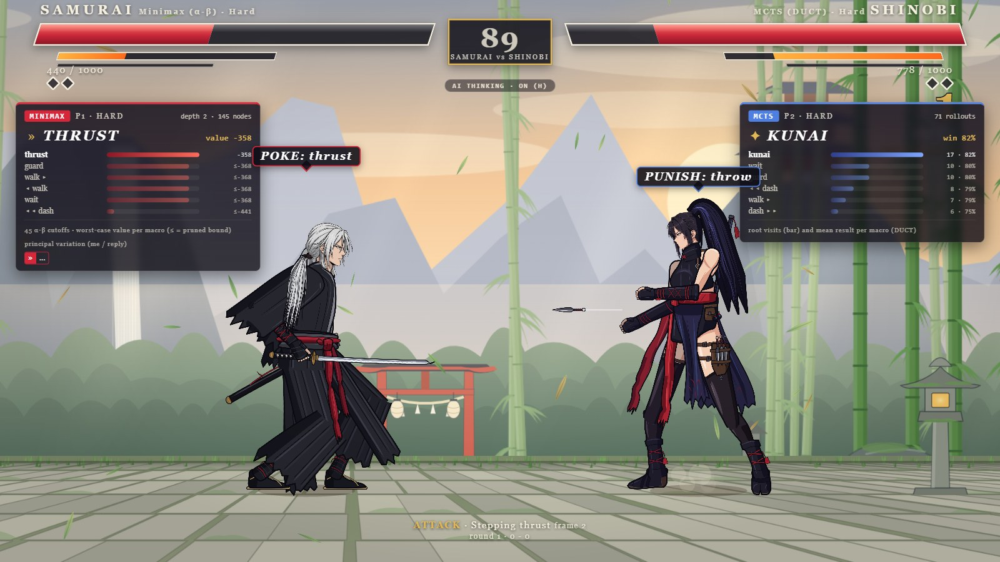</div>

**Left card: Minimax** (red). `depth 2 · 145 nodes` is how deep and wide it searched. **THRUST** is the move it
picked, and `value −358` is that move's *guaranteed worst case*. The bars rank every macro by worst-case value; `≤`
marks values that alpha-beta only *bounded* because it proved they couldn't win. Below are the α-β cutoffs and the
**principal variation** (the line it expects: my move / their reply).

**Right card: MCTS** (blue). `71 rollouts` were simulated, and **KUNAI** was the most visited macro with an estimated
**win 82 %**. Each bar is a macro's visit count, followed by its mean result.

**Speech bubbles** over the heads (`POKE: thrust`, `PUNISH: throw`) name each decision for half a second.

Layout adapts to the device. **Full** cards on desktops; **compact** cards (pick + top 3) on small windows and tablets;
a **one-line ticker** under the timer on phones, where your touch controls own the corners. Hide or show it with
**H**, the *AI THINKING* chip, the **AI** button on touch, or *OPTIONS → AI THINKING OVERLAY*.

---

## 📊 Benchmarks

Measured with the headless arena (`game/tools/arena.mjs`): **3,000 matches** in the Samurai **mirror** (same character on
both sides, so any difference comes from the *algorithm*), about **8 ms per decision** for everyone, a 9-frame reaction
delay, **200 matches per pairing** with sides swapped, and Wilson 95 % confidence intervals.

<div align="center">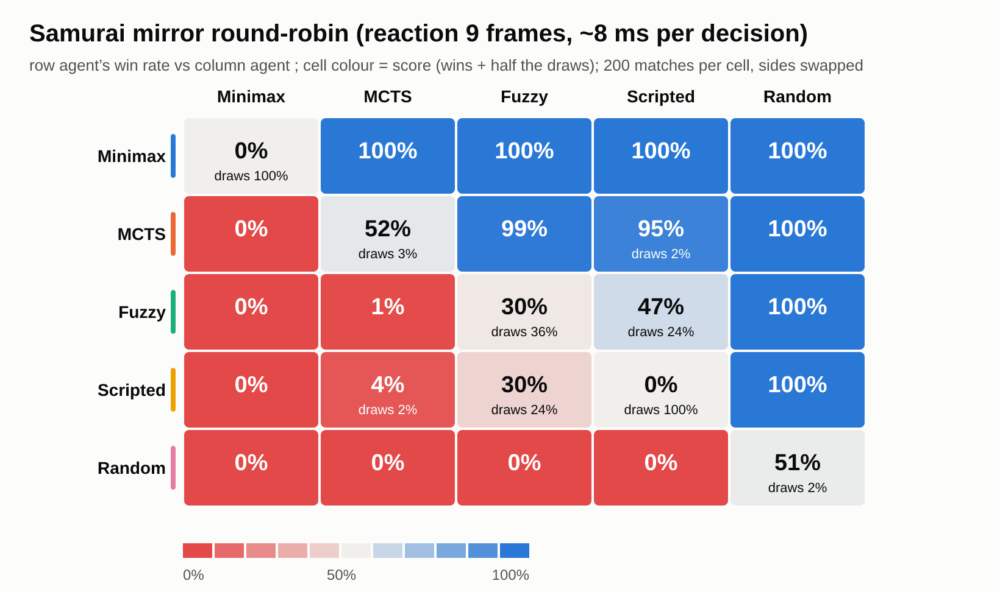</div>

- **At equal compute, pessimistic search wins in this game.** Minimax beat MCTS, Fuzzy and Scripted **200 / 200 each**.
  The Samurai's main poke is long and slow, so whiffs are punished hard, and maximin never whiffs.
- **MCTS is a clear second**: 99 % vs Fuzzy, 95 % vs Scripted, and its mirror is a fair 52 / 46.
- **Sanity holds**: every agent beats Random 100 %, non-deterministic mirrors sit near 50 %, P1/P2 rates agree (no side bias).

### Strength vs thinking time: a cliff and a slope

<table>
<tr>
<td width="50%">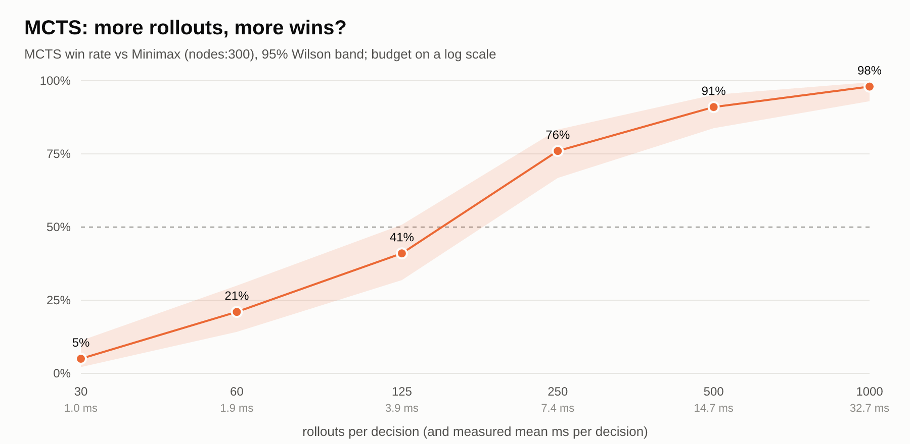</td>
<td width="50%">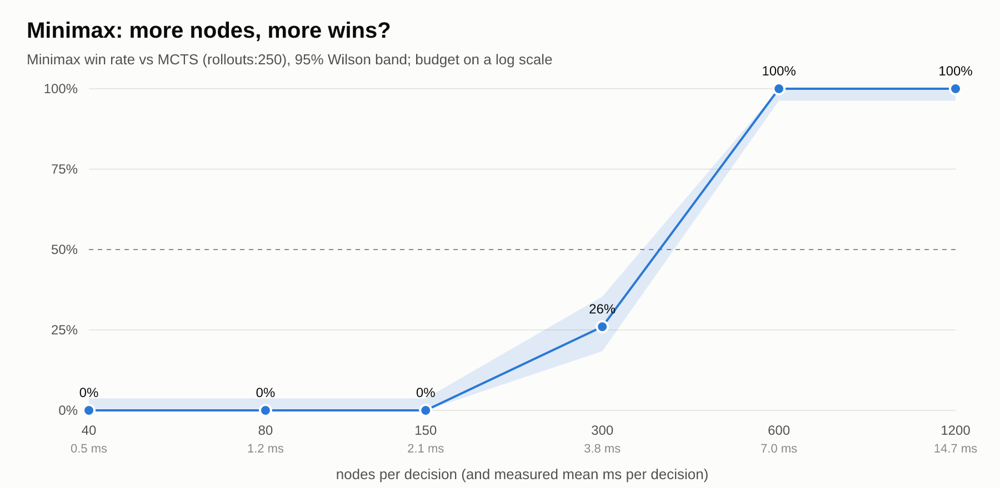</td>
</tr>
</table>

**MCTS improves smoothly** with more rollouts: 5 % → 98 % against a 300-node Minimax as rollouts go from 30 to 1,000.
**Minimax falls off a cliff**: with fewer than ~300 nodes it can't see the reply to its reply and loses everything to MCTS;
once depth 2 completes (≥ 600 nodes) it wins 100 %. *Which algorithm is "better" depends on the time budget.*

---

## 🎚 Difficulty levels

The same three knobs apply to every algorithm (`game/src/ai/difficulty.js`):

| Level | Thinking time | Reaction delay | Mistakes | Notes |
|---|---|---|---|---|
| **Easy** | 2 ms (≈ 150 nodes / 60 rollouts) | 22 frames | 20 % | |
| **Normal** | 8 ms (≈ 600 / 240) | 14 frames | 8 % | |
| **Hard** | 16 ms (≈ 1,200 / 480) | 9 frames | 2 % | |
| **Master** | 50 ms in a **Web Worker** | 6 frames | 0 % | full search without dropping frames |

A *mistake* replaces the chosen macro with a random legal one; the overlay marks it as a **slip**.

---

## 🧠 The Master level: thinking one move ahead

Master searches about **3× longer than Hard** (50 ms per decision), and a 50 ms search on the main thread would drop
frames, so it runs in a **Web Worker**. The naive version, asking the worker at the decision point and waiting for the
answer, left the fighter standing still for ~3 frames on *every* decision: in the benchmark that version **lost 0 / 4
to Hard**, while the same search without the delay won 8 / 8. So Master now pipelines its thinking
(`game/src/ai/speculate.js`, `remote.js`, `worker.js`):

1. The moment a move starts, Master **predicts the position at its next decision point**, playing its own move to the
   end under several opponent behaviours (keeps doing what it does, stops, guards, walks in, backs off, crouches).
2. The worker **searches those predicted positions**, most likely first, while the move plays out, and every 6 frames
   it gets a **fresh prediction** from the newest view of the opponent.
3. At the decision point, if a prediction came true (same states, no hit landed, positions within a few units), its
   answer is used **instantly**: a Master-quality move with zero delay.
4. If the opponent did something new, a Hard-strength search decides on the spot, so Master is never slower and never
   weaker than Hard.

About **75–85 %** of Master's moves come straight from the look-ahead search. Benchmarked in Node with the browser's
worker delay emulated exactly (`arena.mjs --l1 master --l2 hard --lat1 3`), same character, same algorithm, 12 matches
per pairing with sides swapped:

| Master vs Hard | Minimax | MCTS |
|---|---|---|
| Samurai mirror | **11–1** (+23 % HP per round) | **11–1** (+40 %) |
| Shinobi mirror | **11–1** (+48 %) | **11–1** (+42 %) |

---

## 🎮 Controls

| | Keyboard |
|---|---|
| Move | **A / D** (or arrows) · double-tap forward = run (Shinobi) · double-tap back = back-hop |
| Jump / crouch | **W / S** (Shinobi) |
| Attacks | **J** light · **K** kick / thrust · **L** heavy · **I** kunai · **U** ultimate |
| Guard / dash | **Space** (hold) · **Shift** |
| Specials | **Space + J**: Kawarimi (Shinobi) / Repel (Samurai) |
| Game | **Esc** menu · **H** AI overlay · **G** hit boxes · **P** pause · **M** mute · **F1** move list |

Menus work with keyboard (WASD / arrows, Enter, Esc), mouse and touch.

---

## 📱 Playing on a phone

<div align="center">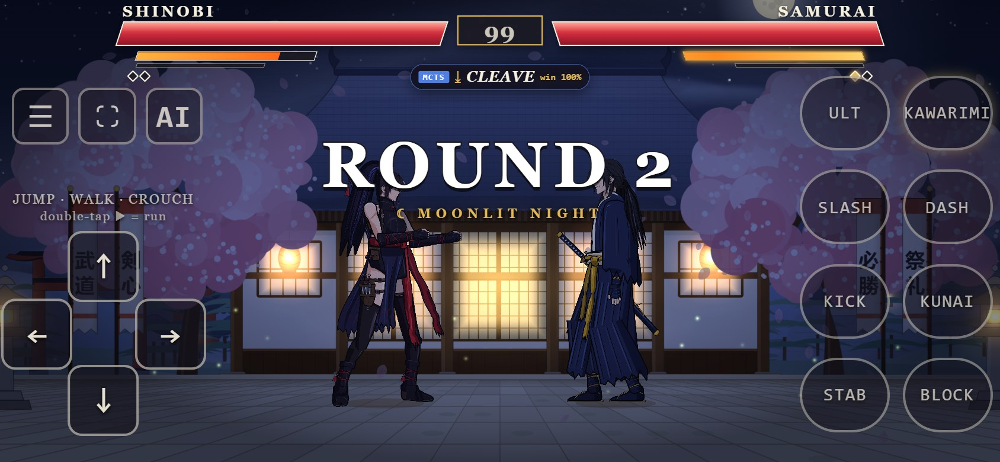</div>

- **Touch controls**: a D-pad on the left, labelled move buttons on the right (they rename per character), and a
  **☰ / ⛶ / AI** chip row. Drag any of the three groups anywhere with *OPTIONS → MOVE BUTTONS*; positions are saved.
- **Any aspect ratio**: wide phones show more of the stage at the sides, tablets show more sky and floor, ultrawide
  monitors fill edge to edge. The HUD and menus stay in a safe 16:9 frame.
- **Install it**: open the site and choose *Add to Home Screen*. It launches fullscreen in landscape with its own icon.
- Lighter on phones: capped pixel ratio, fewer weather particles, compressed art (the whole game is about 24 MB).

---

## 🏗 Architecture

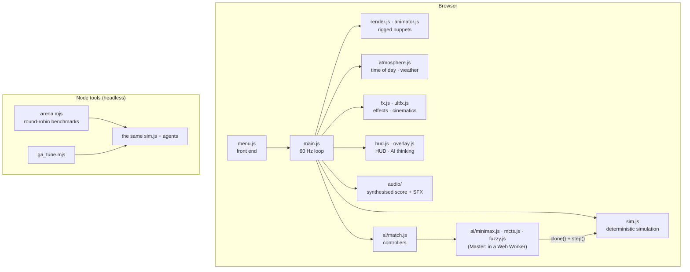

The rule that makes everything else possible: **the simulation never renders and the renderer never changes the
simulation.** The same `sim.js` and agents run in the browser at 60 fps and headless in Node at about 2 M frames per
second for the benchmarks, and every replay is checked against state hashes.

**Stack.** Plain JavaScript ES modules, no bundler, no framework · [PixiJS v8](https://pixijs.com) for WebGL rendering ·
characters are **rigged SVG cut-out puppets** generated by code (`art/<char>/`), with raster face expressions · stages are
layered SVGs generated by `game/tools/build_stage*.mjs` · music and SFX are synthesised in a Web Worker at load.

```
algo-fighter/
├── game/
│   ├── index.html            page + all CSS (HUD, menus, touch UI)
│   ├── src/
│   │   ├── main.js           boot, 60 Hz loop, game modes
│   │   ├── sim.js            deterministic fighting-game simulation
│   │   ├── characters/       Shinobi + Samurai frame data
│   │   ├── ai/               minimax · mcts · fuzzy · baselines · macros · eval · difficulty
│   │   │                     · speculate + remote + worker (Master's look-ahead in a Web Worker)
│   │   ├── atmosphere.js     time of day + weather
│   │   ├── stage.js          parallax stages
│   │   ├── render.js         puppets + camera (animator.js: pose blending)
│   │   ├── fx.js · ultfx.js  hit effects, ultimates, cinematics
│   │   ├── hud.js · overlay.js · menu.js · showcase.js · touch.js
│   │   └── audio/            synthesised music + sound
│   ├── assets/               stages (SVG), UI art, voices
│   ├── replays/              recorded matches (verified on playback)
│   └── tools/                arena, GA, tests, asset builders
├── art/                      character rigs (SVG parts, poses, palettes, faces)
├── paper/                    project report + presentation (PDF, and the slides with animations)
├── readme/                   the images in this README
├── vercel.json               static deploy config
└── .vercelignore             upload only what the game loads
```

---

## 💻 Run it locally

No build step. On Windows, double-click **`Play Algo Fighter.bat`**; anywhere else, from the repository root:

```bash
python play.py
```

It serves the game, opens <http://localhost:8766/game/> and prints an address a phone on the same Wi-Fi can open. (Any
static server works too, as long as it serves the **repository root**: `python -m http.server 8766`.)

**Handy URL presets** (skip the menus):

| URL | What it does |
|---|---|
| `game/index.html?mode=ava&p1=samurai&p2=shinobi&a1=minimax&a2=mcts&l1=hard&l2=hard&autostart=1` | CPU vs CPU, Minimax vs MCTS |
| `game/index.html?mode=ava&p1=samurai&p2=shinobi&a1=minimax&a2=mcts&l1=master&l2=master&autostart=1` | Master vs Master |
| `game/index.html?mode=replay&replay=replays/demo_samurai_vs_shinobi.json&autostart=1` | watch the demo replay (both ultimates) |
| `…&weather=night` (or `dusk`, `storm`, `snow`, `rain`, `dawn`, `day`, `random`) | force the time of day / weather |
| `…&touch=1` | show the touch controls on a desktop |

---

## 🧪 Tests

```bash
node game/tools/replay_hash.mjs
```

```bash
node game/tools/test_agents.mjs
```

```bash
node game/tools/test_clone.mjs
```

- `replay_hash`: 3,600 frames must hash identically to the recorded baseline (catches any accidental change to the simulation).
- `test_agents`: alpha-beta returns exactly the plain-maximin value with ≈ 90 % fewer nodes; agents never receive the live sim; seeded matches replay identically.
- `test_clone`: `clone()` / `hash()` correctness and speed.
- More: `test_samurai.mjs`, `test_ai_moveset.mjs`, `test_audio.mjs`, and the benchmark arena `arena.mjs`.

---

## 🚀 Deploy

The live build at **[algo-fighter.vercel.app](https://algo-fighter.vercel.app)** is a static Vercel deployment of this
repository: `vercel.json` sends `/` to `/game/`, and `.vercelignore` uploads only the game and the character rigs
(about 24 MB). Import the repo on Vercel with the **Other** preset, no build command and output directory `.`. Every push
to `main` redeploys. Before deploying new art, run `python game/tools/optimize_web.py` to shrink the face and menu
images.

---

## 📄 Report & presentation

- **[Project report (PDF)](paper/Algo_Fighter_Report.pdf)**: the formal write-up: game rules as a search problem, the
  Minimax and MCTS formulations with worked traces from real matches, difficulty presets and benchmarks.
- **[Presentation (PDF)](paper/Algo_Fighter_Presentation.pdf)**: the final presentation, 36 slides, step by step
  through how each algorithm decides. The **[.pptx version](paper/Algo_Fighter_Presentation.pptx)** keeps the
  gameplay animations and videos.

---

## 📚 References

1. D. Churchill, A. Saffidine, and M. Buro, "Fast Heuristic Search for RTS Game Combat Scenarios," in *Proceedings of the
   Eighth AAAI Conference on Artificial Intelligence and Interactive Digital Entertainment (AIIDE)*, 2012, pp. 112–117.
   [Paper](https://doi.org/10.1609/aiide.v8i1.12527)
2. M. J. W. Tak, M. Lanctot, and M. H. M. Winands, "Monte Carlo Tree Search Variants for Simultaneous Move Games," in
   *Proceedings of the IEEE Conference on Computational Intelligence and Games (CIG)*, 2014, pp. 1–8.
   [Paper](https://mlanctot.info/files/papers/cig14-smmctsggp.pdf)
3. M. Lanctot, C. Wittlinger, M. H. M. Winands, and N. G. P. Den Teuling, "Monte Carlo Tree Search for Simultaneous Move
   Games: A Case Study in the Game of Tron," in *Proceedings of the 25th Benelux Conference on Artificial Intelligence
   (BNAIC)*, 2013. [Paper](https://dke.maastrichtuniversity.nl/m.winands/documents/sm-tron-bnaic2013.pdf)

Simultaneous-move search follows these works: maximin over joint moves for real-time combat [1], and decoupled UCT for
simultaneous-move MCTS [2, 3].

---

<div align="center">

**Algo Fighter** · CSE 3210 Artificial Intelligence Laboratory · KUET

Built by **Rafsan Riasat** and teammate **[Adib Raian](https://github.com/aaddiibb)**

*Two fighters. Three minds. One deterministic world.*

**[▶ Play now](https://algo-fighter.vercel.app)**

</div>
